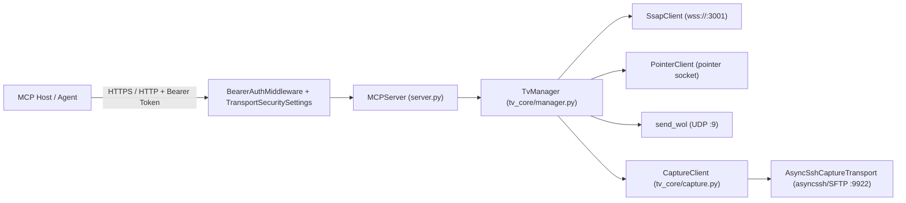

# Architecture

`lg-smtv-mcp` is a stateful, LLM-free Model Context Protocol (MCP) server for local-network control of a single pre-paired LG webOS Smart TV. This document describes the canonical present-state architecture implemented on `main` (Milestone M1 control plane plus the Milestone M2 Developer Mode capture slice).

## System Overview

The server runs primarily as a persistent `streamable-http` ASGI daemon (via `uvicorn` and FastMCP's `MCPServer`), with `stdio` supported for local test harnesses. A single-owner connection loop inside [`TvManager`](src/lg_smtv_mcp/tv_core/manager.py) maintains warm SSAP WebSocket and `subscribe` state, acquires ephemeral pointer sockets on demand, and exposes bounded control tools over [`server.py`](src/lg_smtv_mcp/server.py).

## Architectural Principles

- **LLM-free control plane:** No model SDKs, API keys, or internal vision loops exist in the server; decision loops live in the MCP host.
- **Boundary validation vs. internal state:** Operator inputs and environment config are validated at startup via frozen Pydantic v2 [`TvConfig`](src/lg_smtv_mcp/config.py) (`extra="forbid"`), raising [`ConfigError`](src/lg_smtv_mcp/errors.py). Runtime TV and protocol failures raise [`TvError(ErrorCode, message)`](src/lg_smtv_mcp/errors.py), mapped to FastMCP `ToolError`.
- **Fail-fast standby (`1008`):** WebSocket close code `1008` transitions [`TvManager`](src/lg_smtv_mcp/tv_core/manager.py) to `STANDBY_OFFLINE`. Mutating tools fail fast with `TV_OFFLINE_STANDBY` without implicitly sending Wake-on-LAN; read-only `get_state` bypasses `ui_lock` and returns cached fields with `connected: false, stale: true`.
- **Single-owner connection loop:** One background loop owns `wss://<TV_IP>:3001` transitions (`CONNECTING`, `CONNECTED`, `STANDBY_OFFLINE`, `WAKING`, `PAIRING_REQUIRED`), preventing races between stepped reconnect backoff (`2s -> 5s -> 15s -> 30s`) and coalesced `wake()` calls (`45s` `WAKE_TIMEOUT`).
- **Protocol-injected testability:** External I/O boundaries (`WebSocketConnectFn`, `WebSocketTransport`, `CaptureTransport`, `FrameCapturer`, `wol_fn`, `wait_fn`) are injected into `tv_core` so all automated tests run offline without touching physical hardware.

## Components & Responsibilities

| Component | Location | Responsibility |
| :--- | :--- | :--- |
| Config & Errors | [`config.py`](src/lg_smtv_mcp/config.py), [`errors.py`](src/lg_smtv_mcp/errors.py) | Stdlib `.env` fallback loader, frozen Pydantic `TvConfig`, `ConfigError` vs. `TvError(ErrorCode, message)`. |
| Transport Protocols | [`tv_core/protocols.py`](src/lg_smtv_mcp/tv_core/protocols.py) | `WebSocketTransport`, `WebSocketConnectFn`, `WebSocketClosedError`, `CaptureTransport`, `FrameCapturer`, and frozen result dataclasses (`TvStatus`, `TvStateSnapshot`, `CaptureResult`, `KeysResult`, `TextResult`). |
| SSAP Client | [`tv_core/ssap.py`](src/lg_smtv_mcp/tv_core/ssap.py) | `SsapClient` single-reader `_reader_loop()` multiplexing `msg["id"]` responses and `subscribe` callbacks; 16-permission `register` payload; `1008` and `401` mapping; pending `Future` failure on disconnect. |
| Pointer Client | [`tv_core/pointer.py`](src/lg_smtv_mcp/tv_core/pointer.py) | `PointerClient` button allowlist normalization/validation (rejecting `\r`/`\n` and unknown keys), `type:button` framing, pacing, and single mid-batch socket re-acquire. |
| TV Manager | [`tv_core/manager.py`](src/lg_smtv_mcp/tv_core/manager.py) | `TvManager` state machine, `send_wol`, `subscribe` state cache (`audio/getStatus`, `getForegroundAppInfo`), `ui_lock` (`25s` timeout), `CLIENT_KEY_PATH` reload on backoff/`SIGHUP`, and tool-backing operations. |
| Developer Mode Capture | [`tv_core/capture.py`](src/lg_smtv_mcp/tv_core/capture.py) | `CaptureClient` (`FrameCapturer`) triggers `executeOneShot` and pulls the JPEG; `AsyncSshCaptureTransport` (`CaptureTransport`) lazily opens/reuses the `asyncssh` SFTP session, sweeps stale `/tmp/lg_smtv_cap_*` files while excluding the in-flight capture, and enforces the `6.0s` read deadline plus `1.5s` shielded remove grace. |
| HTTP Auth & Security | [`auth.py`](src/lg_smtv_mcp/auth.py) | `BearerAuthMiddleware` (`hmac.compare_digest` on `Authorization: Bearer <token>`) and `build_transport_security_settings` for DNS-rebinding protection. |
| MCP Server | [`server.py`](src/lg_smtv_mcp/server.py) | `create_mcp_server` / `create_http_app`, ASGI `lifespan` (`TvManager.start()`/`close()` + `SIGHUP`), `ToolError` mapping, 12 default tools + opt-in `raw_ssap`, `TextContent`/`ImageContent` formatting. |
| CLI Entrypoint | [`cli.py`](src/lg_smtv_mcp/cli.py), [`__main__.py`](src/lg_smtv_mcp/__main__.py) | `lg-smtv-mcp serve` (`streamable-http` with fail-closed token check, or `stdio`) and `lg-smtv-mcp pair` (atomic `0600` `.client_key.json` write + optional `--fetch-ssh-key`). |

## Data Flow & Lifecycle

1. **Startup:** `cli.py serve` loads [`TvConfig`](src/lg_smtv_mcp/config.py), requires `MCP_BEARER_TOKEN` for `streamable-http`, builds the ASGI app via [`create_http_app`](src/lg_smtv_mcp/server.py), and starts `uvicorn`. The ASGI `lifespan` starts [`TvManager`](src/lg_smtv_mcp/tv_core/manager.py) and registers `SIGHUP` for `.client_key.json` reload.
2. **Steady-state & Subscriptions:** When connected, `SsapClient._reader_loop()` routes incoming frames by `msg["id"]` to either awaiting request `Future`s or `subscribe` handlers updating `TvState` (`volume`, `muted`, `sound_output`, `foreground_app`, `last_updated`).
3. **Serialized UI Control:** `send_keys`, `type_text`, and `screenshot` acquire `ui_lock` with a `25s` timeout (`LOCK_TIMEOUT`). `create_mcp_server` default-wires `TvManager(..., capture_client=CaptureClient(AsyncSshCaptureTransport(config)))`, so `capture=True` captures over SFTP; when the capture transport is unavailable (Developer Mode SSH off or expired), `send_keys` and `type_text` return partial success with `capture_error="SCREENSHOT_UNAVAILABLE: ..."` while `screenshot` fails with `SCREENSHOT_UNAVAILABLE`. `TvManager` closes the SFTP session on standby and transport transitions.
4. **Shutdown:** ASGI `lifespan` exit removes the `SIGHUP` handler and awaits `TvManager.close()`, tearing down background tasks and open transports cleanly.

## Boundaries

- **Network & Auth:** HTTP requests pass through `TransportSecuritySettings` (DNS-rebinding allowlist from `HOST`/`PORT`/`ALLOWED_HOSTS`) and `BearerAuthMiddleware` (`401` on missing/invalid token).
- **Device Boundary:** SSAP (`wss://<TV_IP>:3001`, `ssl.CERT_NONE`), pointer socket (`ws://` / `wss://` returned by `getPointerInputSocket`), WoL (`UDP` broadcast to `WOL_BROADCAST:9`), and Developer Mode SSH/SFTP (`prisoner@<TV_IP>:9922` with `config=[]` and explicit `ssh-rsa` host-key/signature algorithms). Host-key verification is disabled by default on a trusted LAN (`known_hosts=None`) and can be pinned with `SSH_KNOWN_HOSTS_PATH`.
- **Persistence:** Client pairing keys are stored as `{ip: client_key}` JSON at `CLIENT_KEY_PATH` (written atomically via `os.replace` with `0600` permissions); optional SSH key retrieval in `pair --fetch-ssh-key` writes with `0600` permissions.

## Dependencies

- **Runtime (`pyproject.toml` / `flake.nix`):** Python `>=3.14`, `websockets`, `mcp`, `pydantic`, `asyncssh`, `uvicorn`.
- **Development / Verification:** `pytest`, `pytest-asyncio`, `httpx`, `ruff`, `pyright` (strict mode).

## Architectural Constraints

- Python `>=3.14` (PEP 649 lazy annotations; `from __future__ import annotations` is banned via Ruff `TID251`).
- `pyright` runs in `strict` mode across `src/` and `tests/`.
- Screenshot capture shares a `6.0s` deadline over `executeOneShot` + SFTP read, plus a `1.5s` shielded cleanup grace, inside the `25s` `ui_lock` budget.
- All automated tests run offline against injected `Protocol` doubles; physical TV hardware is never contacted during automated runs.

## Decision Log Index

- [ADR-0001: Streamable HTTP Daemon with Stdio Fallback](docs/adr/0001-streamable-http-daemon-with-stdio-fallback.md)
- [ADR-0002: LLM-Free MCP Server with Composite Tools](docs/adr/0002-llm-free-mcp-server-with-composite-tools.md)
- [ADR-0003: Asyncssh Protocol Boundary for Dev Mode Capture](docs/adr/0003-asyncssh-protocol-boundary-for-dev-mode-capture.md)
- [ADR-0004: Sequenced Temp Captures with Cleanup and Sweep](docs/adr/0004-sequenced-temp-captures-with-cleanup-and-sweep.md)
- [ADR-0005: Opt-In Raw SSAP Tool Gating](docs/adr/0005-opt-in-raw-ssap-tool-gating.md)
