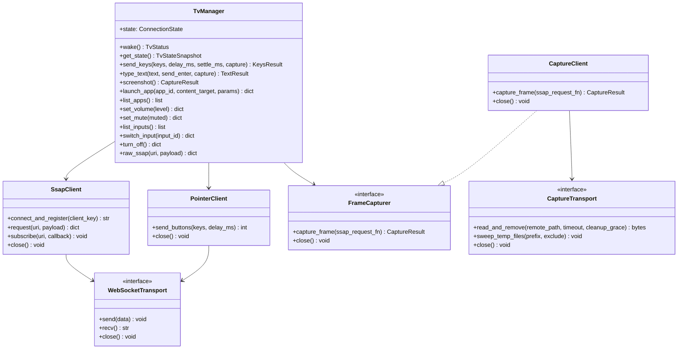
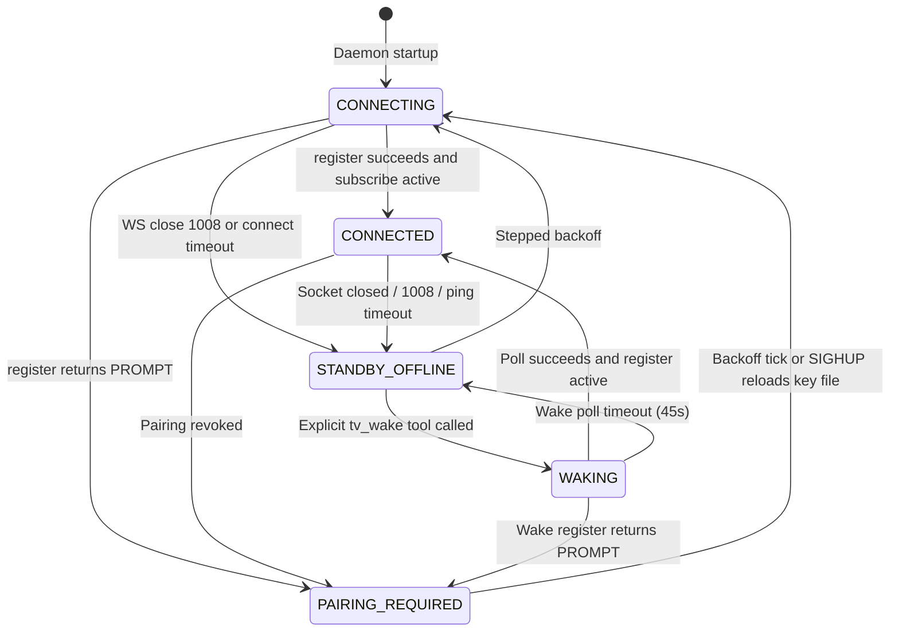

# lg-smtv-mcp

*   **Author:** kiskaadee
*   **Status:** Approved
*   **Date:** 2026-11-15
*   **Last reconciled:** 2026-11-17 (M2 fully delivered: `#13` / PR [#16](https://gitea.roadtotech.me/kiskaadee/lg-smtv-mcp/pulls/16) merged; Milestone M2 closed)

--------------------------------------------------------------------------------

## Overview

`lg-smtv-mcp` is a Python Model Context Protocol (MCP) server for local-network control of a single pre-paired LG webOS Smart TV. It runs primarily as a long-lived `streamable-http` daemon on a homelab server on the same LAN (with `stdio` supported for local testing), keeping the Simple Service Access Protocol (`SSAP`, LG webOS's local JSON-over-WebSocket control protocol on `wss://<TV_IP>:3001`), pointer input socket, and `subscribe` state cache warm, and lazily opening a reusable [LG Developer Mode](https://webostv.developer.lge.com/develop/getting-started/developer-mode-app) `asyncssh`/SFTP session (`prisoner@<TV_IP>:9922`) across captures while the TV is awake. The server contains no LLM or vision-model calls: UI navigation loops live in the MCP host (such as Antigravity, Claude, or a closed-set action-router model like `gemini-decision-1`), while `lg-smtv-mcp` exposes bounded, deterministic tools and composite actions (such as batched key sequences with optional inline `ImageContent` screenshots, frame-hash change flags, and gated raw SSAP access).

## The Problem

Controlling an LG webOS TV from an AI agent or automation host using one-shot CLI scripts introduces measurable per-step connection overhead and protocol hazards (documented in [docs/poc/capabilities.md](../poc/capabilities.md) and [docs/poc/crunchyroll-e2e-experiment.md](../poc/crunchyroll-e2e-experiment.md) against `WebOS/4.1.0`):

1. **Per-step handshake overhead:** In the Crunchyroll PoC ([docs/poc/crunchyroll-e2e-experiment.md](../poc/crunchyroll-e2e-experiment.md)), navigating from app launch to episode playback took 13 steps and `427s` (~7 minutes), largely because each step spawned a fresh process, `wss://:3001` TLS + `register` handshake, `getPointerInputSocket` connection, and `scp` session (~8–10s per step).
2. **Protocol hazards on persistent connections:** Running `subscribe` streams (`audio/getStatus`, `getForegroundAppInfo`) concurrently with tool calls breaks one-shot `ws.recv()` patterns. Additionally, when the TV is in standby, `wss://:3001` accepts the WebSocket upgrade and closes immediately with `1008 (Try Again Later (EWS))`, and `ime/insertText` silently returns `returnValue: true` even when the native keyboard is closed.
3. **Redundant host round-trips and `/tmp` accumulation risk:** Without batched key execution, inline image return, and deterministic frame-change detection (`frame_sha256`), the host must issue separate key and capture calls and cannot detect unchanged frames without inspecting image bytes. Without per-call `/tmp` cleanup, repeated screenshot files accumulate in the TV's `/tmp` filesystem (~1.2 GB system RAM).

`lg-smtv-mcp` addresses this by maintaining persistent, serialized SSAP and pointer connections inside a homelab `streamable-http` daemon (implemented in M1), failing fast on `1008` standby, and implementing optional Developer Mode SFTP capture (M2 `#12`, merged in PR `#15`) so SSH expiration degrades only screenshot capture while returning compact state and image payloads.

## Goals

*   Run a continuous `streamable-http` MCP daemon bound to a configurable `HOST` address (defaulting to `127.0.0.1` locally, or a trusted homelab LAN interface when deployed) with `Authorization: Bearer <token>` verification via `hmac.compare_digest`, plus `stdio` transport for local test harnesses.
*   Maintain persistent SSAP (`wss://:3001`), pointer input socket, and `subscribe` state cache connections inside `tv_core`, plus an on-demand `asyncssh`/SFTP (`:9922`) session that stays open across captures while the TV is online and closes on standby.
*   Serialize stateful UI and capture operations (`keys`, `type_text`, `screenshot`) with bounded contention while keeping read-only state queries non-blocking.
*   Fail fast on WebSocket close code `1008` (`TV_OFFLINE_STANDBY`) for mutating tools, return cached flat fields with `connected: false, stale: true` for read-only queries, and provide an explicit `tv_wake` tool using configurable Wake-on-LAN broadcast.
*   Expose bounded composite tools (`keys` with allowlisted buttons, delays, and optional inline `ImageContent`; `type_text`; `launch` with deep-link helpers; `screenshot` with `frame_sha256` and `changed_since_last`; `set_volume` with configurable `max_volume=40` cap; explicit `turn_off` / `switch_input`; and opt-in `ENABLE_RAW_SSAP=true`).
*   Provide a one-time CLI `pair` command for interactive on-screen `PROMPT` registration, `client-key` persistence, and optional `--fetch-ssh-key` Developer Mode key retrieval.
*   Verify M1 and M2 behavior offline via `pytest` contract tests over `Protocol` mocks, passing `ruff` and `pyright` inside `nix develop`.

## Non-Goals

*   Embedding LLM/VLM API keys, outbound model calls, or an internal vision-navigation loop inside `lg-smtv-mcp`.
*   Adding an extra HTTP or IPC wrapper service behind the MCP server.
*   Exposing arbitrary SSH command execution on the TV or retaining screenshot files in `/tmp`.
*   Multi-TV fleet management or interactive `PROMPT` pairing inside MCP tool calls.
*   Implicitly waking the TV on normal control or state-query calls.

## Open Questions

None.

## Critical User Journeys (CUJs)

### CUJ 1: Standby Detection and Explicit Wake

*   **Given**: The TV is in standby (`wss://<TV_IP>:3001` closes with `1008 Try Again Later (EWS)`), and the daemon is running in `STANDBY_OFFLINE` state.
*   **When**: An MCP client calls `launch("youtube.leanback.v4")`.
*   **Then**: The tool fails fast with `TV_OFFLINE_STANDBY` without sending a Wake-on-LAN packet. The client then calls `tv_wake`, which broadcasts the WoL magic packet to `<TV_MAC>` on the configured broadcast address/port, polls until `1008` clears and `register` + `subscribe` succeed (`~30–35s` typical cold wake within a `45s` budget), and returns the online status.

### CUJ 2: Vision-Guided UI Navigation with Batched Keys and Change Detection

*   **Given**: The TV is online and Developer Mode SSH (`:9922`) is active.
*   **When**: A host decision loop calls `keys(["LEFT", "UP", "ENTER"], delay_ms=250, settle_ms=1000, capture=True)`.
*   **Then**: `tv_core` serializes the operation, validates key names against the allowlist, sends the three button frames over the persistent pointer socket, waits `settle_ms`, captures and cleans up the remote screenshot into memory, and returns `keys_sent: true`, inline `ImageContent`, `frame_sha256`, and `changed_since_last`.

### CUJ 3: Graceful Degradation When Developer Mode SSH Expires

*   **Given**: The TV is online, SSAP and pointer sockets are connected, and Developer Mode SSH (`:9922`) is disabled or expired.
*   **When**: A client calls `keys(["DOWN", "ENTER"], capture=True)` or `set_volume(15)`.
*   **Then**: `set_volume(15)` succeeds. `keys(..., capture=True)` executes the keystrokes and returns partial success (`keys_sent: true`, `capture_error: "SCREENSHOT_UNAVAILABLE: ..."`) so the caller knows not to re-send the keys.

### CUJ 4: One-Time CLI Pairing

*   **Given**: A new or reset TV has no saved `client-key` on the homelab server.
*   **When**: The operator runs `lg-smtv-mcp pair --ip <TV_IP>` (optionally with `--fetch-ssh-key`) from the terminal and accepts the on-screen `PROMPT` with the physical remote.
*   **Then**: The CLI saves the returned `client-key` (and optional `webos_rsa` with `0600` permissions) to the configured path, allowing the `streamable-http` daemon to start and register non-interactively.

## Technical Plan (Architecture)

### 1. Package & Module Layout

All runtime code lives under `src/lg_smtv_mcp/`, separating the transport/protocol boundaries and state machine (`tv_core`) from the MCP tool surface (`server.py`, built on FastMCP—the high-level `MCPServer` API in the official Python `mcp` SDK), HTTP Bearer auth (`auth.py`), and CLI entrypoints (`cli.py`).

| Module | Responsibility |
| :--- | :--- |
| [`src/lg_smtv_mcp/config.py`](../../src/lg_smtv_mcp/config.py) | Frozen Pydantic v2 `TvConfig` (`extra="forbid"`) loaded from env vars / `.env` (`TV_IP`, `TV_MAC`, `WOL_BROADCAST`, `CLIENT_KEY_PATH`, `SSH_KEY_PATH`, `WEBOS_SSH_PASSPHRASE`, `SSH_KNOWN_HOSTS_PATH`, `HOST`, `PORT`, `ALLOWED_HOSTS`, `MCP_BEARER_TOKEN`, `MAX_VOLUME`, `ENABLE_RAW_SSAP`), raising `ConfigError` on invalid operator config. |
| [`src/lg_smtv_mcp/errors.py`](../../src/lg_smtv_mcp/errors.py) | `ConfigError` for startup/config failures and `TvError(ErrorCode, message)` for runtime TV/tool errors (`TV_OFFLINE_STANDBY`, `PAIRING_REQUIRED`, `SCREENSHOT_UNAVAILABLE`, `LOCK_TIMEOUT`, `WAKE_TIMEOUT`, `COMMAND_FAILED`, `INVALID_ARGUMENT`). |
| [`src/lg_smtv_mcp/tv_core/protocols.py`](../../src/lg_smtv_mcp/tv_core/protocols.py) | Python `Protocol` interfaces (`WebSocketTransport`, `WebSocketConnectFn`, `WebSocketClosedError`, `CaptureTransport`, `FrameCapturer`) and frozen result dataclasses enabling offline contract tests. |
| [`src/lg_smtv_mcp/tv_core/ssap.py`](../../src/lg_smtv_mcp/tv_core/ssap.py) | `SsapClient`: single background reader task routing frames by `msg["id"]` to `asyncio.Future`s and `subscribe` callbacks; `PERMISSIONS` constant; `register` + `1008` detection; WebSocket keepalive and pending-`Future` cleanup on disconnect. |
| [`src/lg_smtv_mcp/tv_core/pointer.py`](../../src/lg_smtv_mcp/tv_core/pointer.py) | `PointerClient`: acquires `getPointerInputSocket`, normalizes/validates keys, sends plain-text `type:button` frames, and automatically re-acquires the socket if dropped. |
| [`src/lg_smtv_mcp/tv_core/capture.py`](../../src/lg_smtv_mcp/tv_core/capture.py) | `CaptureClient` (implementing `FrameCapturer`) and `AsyncSshCaptureTransport` (implementing `CaptureTransport`): calls `executeOneShot` via `ssap_request_fn`, lazily opens/reuses the `asyncssh` SFTP session (`read_and_remove`, `sweep_temp_files`, `close`), excludes the in-flight capture from each session sweep, enforces the shared deadline and shielded cleanup, and tracks `frame_sha256` / `changed_since_last`. |
| [`src/lg_smtv_mcp/tv_core/manager.py`](../../src/lg_smtv_mcp/tv_core/manager.py) | `TvManager`: single-owner connection loop + state machine, `send_wol` helper, `subscribe` state cache, stepped reconnect backoff, `FrameCapturer` teardown on `STANDBY_OFFLINE`, `.client_key.json` reload on `PAIRING_REQUIRED` backoff/`SIGHUP`, and `ui_lock` (`25s` acquire timeout) serializing UI/capture operations. |
| [`src/lg_smtv_mcp/auth.py`](../../src/lg_smtv_mcp/auth.py) | ASGI Bearer token middleware (`hmac.compare_digest` on `Authorization: Bearer <token>`) wrapping FastMCP's `streamable_http_app()` and `TransportSecuritySettings`. |
| [`src/lg_smtv_mcp/server.py`](../../src/lg_smtv_mcp/server.py) | FastMCP (`MCPServer`) tool definitions, `ImageContent` formatting, partial-success shaping, `max_volume` enforcement, `ENABLE_RAW_SSAP` gating, and ASGI `lifespan` wiring for `TvManager` + `SIGHUP`. |
| [`src/lg_smtv_mcp/cli.py`](../../src/lg_smtv_mcp/cli.py) | CLI entrypoint supporting `serve` (`streamable-http` with fail-closed `MCP_BEARER_TOKEN` check, or `stdio`) and one-time interactive `pair` (`.client_key.json` + optional `--fetch-ssh-key`). |

| Component | Key Contract Signatures |
| :--- | :--- |
| `TvManager` | `wake() -> TvStatus`, `get_state() -> TvStateSnapshot`, `send_keys(keys, delay_ms, settle_ms, capture) -> KeysResult`, `type_text(text, send_enter, capture) -> TextResult`, `screenshot() -> CaptureResult`, `launch_app(app_id, content_target, params) -> dict`, `list_apps() -> list[dict]`, `set_volume(level) -> dict`, `set_mute(muted) -> dict`, `list_inputs() -> list[dict]`, `switch_input(input_id) -> dict`, `turn_off() -> dict`, `raw_ssap(uri, payload) -> dict` |
| `SsapClient` | `async connect_and_register(client_key: str \| None) -> str`, `async request(uri: str, payload: dict \| None) -> dict`, `async subscribe(uri: str, callback: Callable[[dict], None]) -> None`, `async close() -> None` |
| `PointerClient` | `async send_buttons(keys: list[str], delay_ms: int) -> int`, `async close() -> None` |
| `FrameCapturer` | `async capture_frame(ssap_request_fn: Callable[[str, dict], Awaitable[dict]]) -> CaptureResult`, `async close() -> None` |
| `CaptureClient` | `__init__(transport: CaptureTransport)`, implements `FrameCapturer` |
| `WebSocketTransport` | `async send(data: str) -> None`, `async recv() -> str`, `async close() -> None` (raises `WebSocketClosedError(code, reason)` on close); `WebSocketConnectFn = Callable[[str], Awaitable[WebSocketTransport]]` |
| `CaptureTransport` | `async read_and_remove(remote_path: str, timeout: float, cleanup_grace: float) -> bytes`, `async sweep_temp_files(prefix: str, exclude: str \| None = None) -> None`, `async close() -> None`; implemented by `AsyncSshCaptureTransport(config: TvConfig, connect_fn: ...)` |

### 2. Connection State Machine, Frame Dispatch & Concurrency

*   **SSAP `msg["id"]` Multiplexer:** `SsapClient` runs one background `_reader_loop()` task that owns `ws.recv()`. Responses to one-shot `request()` calls resolve matching `asyncio.Future`s by `msg["id"]`. Live-verified `subscribe` streams on `WebOS/4.1.0` (`ssap://audio/getStatus`—where `volume` and `mute` are top-level and `soundOutput` is nested under `payload["volumeStatus"]["soundOutput"]`—and `ssap://com.webos.applicationManager/getForegroundAppInfo`) update the in-memory `TvStateSnapshot` in `TvManager`. Mutating requests push subscription update frames before their own request response frame, which `msg["id"]` routing demultiplexes. On disconnect, `_reader_loop()`'s `finally:` block fails all pending `Future`s with `TV_OFFLINE_STANDBY`.
*   **Standby & Fail-Fast:** WebSocket close code `1008` (`Try Again Later (EWS)`), ping timeout (`ping_interval=10, ping_timeout=5`), or `open_timeout` (`3.0–4.0s`) transitions `TvManager` to `STANDBY_OFFLINE` and tears down any open `CaptureClient` SSH/SFTP session (which reconnects lazily on the next capture). Mutating tools fail fast with `TV_OFFLINE_STANDBY` without triggering WoL. Read-only queries (`get_state`) bypass `ui_lock` and return the flat state dict (`connected: false, stale: true` with cached values retained from the last online update).
*   **Single-Owner Reconnect, Wake & Key Reload:** A single connection loop owns `wss://:3001` transitions so `tv_wake` and stepped background reconnect (`2s -> 5s -> 15s -> 30s`) never race. Calling `tv_wake` in `STANDBY_OFFLINE` sends the WoL magic packet, signals the connection loop into `WAKING` (`~1s` polling up to a `45s` `WAKE_TIMEOUT` budget, covering `~30–35s` empirical cold standby boot), and awaits a shared connection event. Concurrent `tv_wake` calls in `WAKING` coalesce onto the in-flight attempt; `tv_wake` in `CONNECTED` returns `{status: "already_connected", elapsed_ms: 0}`; `tv_wake` in `PAIRING_REQUIRED` fails fast with `PAIRING_REQUIRED`. In `PAIRING_REQUIRED`, `TvManager` re-checks `CLIENT_KEY_PATH` (`{ip: client_key}` JSON, written atomically via `os.replace` by `cli.py pair`) on its backoff tick or `SIGHUP` (logging and remaining in `PAIRING_REQUIRED` if the file is missing or malformed).
*   **UI/Capture Serialization & Timeout Budget:** `send_keys`, `type_text`, and `screenshot` acquire `ui_lock` (`asyncio.Lock`) with a `25s` acquire timeout (`LOCK_TIMEOUT` if exceeded). `keys` validates key names against a strict webOS button allowlist (`UP`, `DOWN`, `LEFT`, `RIGHT`, `ENTER`, `BACK`, `HOME`, `EXIT`, `PLAY`, `PAUSE`, `STOP`, `REWIND`, `FASTFORWARD`, `RED`, `GREEN`, `YELLOW`, `BLUE`, `VOLUMEUP`, `VOLUMEDOWN`, `MUTE`, `CHANNELUP`, `CHANNELDOWN`, `INFO`, `GUIDE`, `MENU`, `CC`, `0`–`9`), rejecting unknown names or control characters (`\r`, `\n`) with `INVALID_ARGUMENT`, and bounds `1 <= len(keys) <= 20`, `0 <= delay_ms <= 500`, and `0 <= settle_ms <= 2000`. `CaptureClient.capture_frame()` wraps `executeOneShot` + SFTP read in a shared `6.0s` operation deadline (`asyncio.timeout(6.0)`), while `AsyncSshCaptureTransport.read_and_remove()` enforces its own `timeout` budget and shields its `finally: sftp.remove(remote_path)` under a separate `1.5s` cleanup grace (`asyncio.shield` + `asyncio.wait_for(..., timeout=cleanup_grace)`) so outer timeout cancellation cannot abort remote `/tmp` file deletion (`<= 7.5s` worst-case capture phase within the `25s` `ui_lock` budget). Any new SFTP session runs `sweep_temp_files("/tmp/lg_smtv_cap_", exclude=remote_path)`, so stale captures from earlier sessions or crashes are removed while the frame about to be read survives.

### 3. MCP Tool Surface

All tools return structured JSON payloads (plus inline MCP `ImageContent` when `capture=True` or `screenshot` succeeds).

| Tool | Inputs | Output / Behavior | Error Codes |
| :--- | :--- | :--- | :--- |
| `tv_wake` | *(none)* | Coalesced WoL wake to `<TV_MAC>` via `WOL_BROADCAST`; polls up to `45s`; returns `{status, elapsed_ms}` (`already_connected` if already online). | `WAKE_TIMEOUT`, `PAIRING_REQUIRED` |
| `get_state` | *(none)* | Lock-free read returning flat dict (`connected`, `stale`, `volume`, `muted`, `sound_output`, `foreground_app`, `last_updated`; cached fields retain last known values when `connected: false, stale: true`). | *(never fails on standby)* |
| `keys` | `keys: list[str]`, `delay_ms: int = 250`, `settle_ms: int = 800`, `capture: bool = False` | Validates allowlist and bounds; acquires `ui_lock`; sends pointer buttons; if `capture=True`, captures frame. On SSH failure after keys succeed, returns `{keys_sent: true, count, capture_error}` (partial success). | `TV_OFFLINE_STANDBY`, `PAIRING_REQUIRED`, `LOCK_TIMEOUT`, `INVALID_ARGUMENT` |
| `type_text` | `text: str`, `send_enter: bool = True`, `capture: bool = False` | Acquires `ui_lock`; calls `ime/insertText` + optional `sendEnterKey` (requires native on-screen keyboard to be open); if `capture=True`, captures frame (returning `{text_sent: true, capture_error}` partial success on SSH failure). | `TV_OFFLINE_STANDBY`, `PAIRING_REQUIRED`, `LOCK_TIMEOUT` |
| `screenshot` | *(none)* | Acquires `ui_lock`; captures frame into memory and removes remote temp file; returns `ImageContent` + `{frame_sha256, changed_since_last, size_bytes}`. | `TV_OFFLINE_STANDBY`, `PAIRING_REQUIRED`, `SCREENSHOT_UNAVAILABLE`, `LOCK_TIMEOUT` |
| `launch` | `app_id: str`, `content_target: str \| None = None`, `params: dict \| None = None` | Calls `ssap://system.launcher/launch` with `{"id": app_id, "params": ...}`. When `content_target` is provided, sets `params["contentTarget"] = content_target` (overriding any `params["contentTarget"]`; see [docs/poc/capabilities.md](../poc/capabilities.md)). | `TV_OFFLINE_STANDBY`, `PAIRING_REQUIRED` |
| `list_apps` | *(none)* | Calls `com.webos.applicationManager/listLaunchPoints`; returns compact `[{id, title}]`. | `TV_OFFLINE_STANDBY`, `PAIRING_REQUIRED` |
| `set_volume` | `level: int` | Rejects with `INVALID_ARGUMENT` if `level < 0` or `level > MAX_VOLUME` (default `40`); otherwise calls `audio/setVolume`. | `TV_OFFLINE_STANDBY`, `PAIRING_REQUIRED`, `INVALID_ARGUMENT` |
| `set_mute` | `muted: bool` | Calls `audio/setMute`. | `TV_OFFLINE_STANDBY`, `PAIRING_REQUIRED` |
| `list_inputs` | *(none)* | Calls `tv/getExternalInputList`; returns `[{id, label, connected}]`. | `TV_OFFLINE_STANDBY`, `PAIRING_REQUIRED` |
| `switch_input` | `input_id: str` | Explicit input switch via `tv/switchInput`. | `TV_OFFLINE_STANDBY`, `PAIRING_REQUIRED` |
| `turn_off` | *(none)* | Explicit power off via `system/turnOff`. | `TV_OFFLINE_STANDBY`, `PAIRING_REQUIRED` |
| `raw_ssap` | `uri: str`, `payload: dict \| None = None` | Registered **only** when `ENABLE_RAW_SSAP=true`; forwards single SSAP request. | `TV_OFFLINE_STANDBY`, `PAIRING_REQUIRED` |

### 4. Runtime Configuration, Security & Daemon Deployment

*   **Network, Transport Security & Trust Policy:** `streamable-http` binds to `HOST` (default `127.0.0.1` for local dev; `<SERVER_IP>` on a trusted home LAN when deployed) and `PORT` (default `8765`). Startup fails closed if `MCP_BEARER_TOKEN` is unset or whitespace-only, and every HTTP request requires `Authorization: Bearer <token>` verified via `hmac.compare_digest`. `TransportSecuritySettings` derives `allowed_hosts` / `allowed_origins` from `HOST`/`PORT`, `127.0.0.1`/`localhost`, and optional `ALLOWED_HOSTS`. Because `uvicorn` serves plain HTTP by default, direct LAN binding assumes a trusted home network segment; if accessed across untrusted networks, operators must place the daemon behind an HTTPS reverse proxy / TLS terminator or an encrypted overlay tunnel (e.g., WireGuard or Tailscale). On the TV link (`wss://<TV_IP>:3001`), `SsapClient` uses `ssl.CERT_NONE` because retail LG webOS TVs present a device-generated self-signed certificate without CA chain provisioning; session authorization relies on the paired `client-key` on the local LAN.
*   **ASGI `lifespan` Ownership:** FastMCP (`MCPServer`) / Starlette's ASGI `lifespan` context manager starts `TvManager` on Uvicorn's active event loop, registers `SIGHUP` via `loop.add_signal_handler`, and closes `SsapClient`, `PointerClient`, and `FrameCapturer` on shutdown.
*   **Developer Mode SSH Lifecycle & Host-Key Trust (`#12`):** Retail LG webOS TVs do not serve `/tmp` screenshots over HTTPS (`:3001`), so `CaptureClient` pulls captures over SFTP from the unprivileged SSH server (`prisoner@<TV_IP>:9922`) provided by LG's official [Developer Mode app](https://webostv.developer.lge.com/develop/getting-started/developer-mode-app) (see [docs/poc/capabilities.md](../poc/capabilities.md)). Port `:9922` is available only while "Dev Mode Status" and "Key Server" are enabled on the TV, and LG automatically disables Developer Mode when its countdown timer expires (at which point `CaptureClient` raises `SCREENSHOT_UNAVAILABLE` while all SSAP and WoL tools continue operating). `AsyncSshCaptureTransport` opens its `asyncssh` SFTP connection lazily on the first capture request, reuses it across subsequent captures while the TV stays online, sweeps stale `/tmp/lg_smtv_cap_*` files on each new SFTP session while excluding the in-flight capture path, and closes the session when `TvManager` transitions to `STANDBY_OFFLINE` or on transport errors. On a headless `systemd` service, `AsyncSshCaptureTransport` connects with `config=[]`, legacy `server_host_key_algs=["ssh-rsa"]`, `signature_algs=["ssh-rsa"]`, and either a key path (`SSH_KEY_PATH`) or `WEBOS_SSH_PASSPHRASE`. Because the TV's Developer Mode container regenerates its SSH host key across Developer Mode renewals, `known_hosts=None` is the default on a trusted home LAN (accepting the LAN peer's host key to prevent unattended daemon breakage); operators requiring strict SSH host authentication can set `SSH_KNOWN_HOSTS_PATH` to pin the TV's host key and update that file whenever Developer Mode is re-initialized. `lg-smtv-mcp pair --fetch-ssh-key` retrieves `http://<TV_IP>:9991/webos_rsa` and saves it with `0600` permissions.
*   **WoL Broadcast:** `WOL_BROADCAST` defaults to `255.255.255.255` and can be set to the LAN subnet broadcast (e.g., `<LAN_SUBNET_BROADCAST>`) on multi-homed hosts so magic packets exit on the TV's Ethernet/Wi-Fi segment.

### 5. Offline Testing & Nix Environment

*   **Offline Contract Tests:** All automated tests run offline against injected `WebSocketTransport`, `CaptureTransport`, and `FrameCapturer` implementations (plus fake `wol_fn` and `wait_fn` callbacks). M1 offline coverage (`tests/test_config.py`, `tests/test_protocols.py`, `tests/test_ssap.py`, `tests/test_pointer.py`, `tests/test_manager.py`, `tests/test_auth.py`, `tests/test_server.py`, `tests/test_cli.py`, `tests/test_e2e_mvp.py`) is implemented and passing on `main`. M2 adds `tests/test_capture.py` and hardens `tests/test_e2e_mvp.py`; both are implemented and passing on `main` (PR `#15` and PR `#14`).
*   **`flake.nix` Packaging:** Exposes `packages.${system}.default` via `buildPythonApplication` (`pyproject = true`, `setuptools`, single-sourced `runtimeDeps` and `testDeps`, `preCheck` running `ruff check .`, `ruff format --check .`, `pyright`, and `pytestCheckHook`) and `devShells.${system}.default` with `.githooks` pre-commit enforcement.

## Alternatives Considered

### Alternative A: Single-Process `stdio` Per Client Only

*   **Pros:** Zero HTTP server, port binding, or Bearer token configuration required.
*   **Cons:** Every client session spawns a new process, repeating `wss://:3001` TLS + `register`, `getPointerInputSocket`, and `:9922` SSH handshakes; concurrent clients contend for the TV's single pointer socket.
*   **Reason for Rejection:** `streamable-http` keeps all TV transports and the `subscribe` state cache warm continuously while `stdio` remains available for local test harnesses.

### Alternative B: In-Server Vision Navigation Sub-Loop

*   **Pros:** Could encapsulate multi-step UI navigation behind a single high-level natural-language tool call.
*   **Cons:** Couples a local hardware driver to external LLM/VLM API keys, provider SDKs, model selection, and prompt engineering.
*   **Reason for Rejection:** `lg-smtv-mcp` stays LLM-free; host round-trips and vision-turn overhead are reduced instead via composite tools (`keys(..., capture=True)`) and deterministic `frame_sha256` / `changed_since_last` metadata.

### Alternative C: OpenSSH `ControlMaster` Subprocess for Screenshots

*   **Pros:** Uses system OpenSSH directly for legacy `ssh-rsa` compatibility.
*   **Cons:** Requires managing background `ssh` control sockets, parsing subprocess output/exit codes, and complicates offline unit testing.
*   **Reason for Rejection:** `asyncssh` (`2.24.0`) was verified on Python 3.14 against `:9922` (`config=[]`, explicit `ssh-rsa` algorithms) and wraps behind an async `Protocol` mock.

### Alternative D: Fixed `/tmp/test.jpg` Overwrite Path

*   **Pros:** Bounded to a single file on `/tmp` without explicit delete calls.
*   **Cons:** If `executeOneShot` fails silently or races, SFTP pull can read a stale screenshot from an earlier step.
*   **Reason for Rejection:** Capturing to `/tmp/lg_smtv_cap_<seq>.jpg`, pulling only when `returnValue: true`, calling `sftp.remove()` in a shielded `finally:` block, and sweeping stale files on SFTP connect/reconnect is designed to prevent stale reads and bound `/tmp` file accumulation on the TV's ~1.2 GB RAM.

### Alternative E: Unconditional `raw_ssap` Tool

*   **Pros:** Allows calling arbitrary SSAP URIs at any time without code changes.
*   **Cons:** Expands the tool schema and weakens guardrails (`max_volume`, explicit `turn_off`) for closed-set decision models.
*   **Reason for Rejection:** `raw_ssap` is omitted by default and registered only when `ENABLE_RAW_SSAP=true` is explicitly configured.

--------------------------------------------------------------------------------

## Risks & Mitigations

| Risk | Impact | Mitigation |
| :--- | :--- | :--- |
| Developer Mode SSH timer expires on TV | Screenshot capture fails (`SCREENSHOT_UNAVAILABLE`) | Degrade only `screenshot` / `capture=True` (returning partial success on `keys` / `type_text`); keep all SSAP and WoL tools active. |
| Orphaned `/tmp/lg_smtv_cap_*.jpg` on SSH stall | Gradual `/tmp` RAM growth on TV (~1.2 GB RAM) | Per-call shielded `finally: sftp.remove()` under `1.5s` grace + sweep of `/tmp/lg_smtv_cap_*.jpg` on SFTP connect/reconnect, excluding the in-flight capture path. |
| Concurrent `tv_wake` / reconnect race or cold wake delay | Duplicate sockets or premature `WAKE_TIMEOUT` | Single-owner connection loop coalescing `tv_wake` + `45s` budget (`~30–35s` empirical cold boot). |
| Dev Mode host-key regeneration or LAN peer spoofing on `:9922` | Unattended SSH failure on key rotation, or unauthenticated SFTP peer when `known_hosts=None` | Default `known_hosts=None` on trusted home LAN; support `SSH_KNOWN_HOSTS_PATH` for explicit host-key pinning (updated by operator when Developer Mode regenerates keys). |
| Plain-HTTP bearer token exposure on untrusted networks | Token interception on non-private network segments | Bind to `127.0.0.1` by default; restrict direct LAN binding to trusted home networks or terminate HTTPS via reverse proxy / WireGuard / Tailscale tunnel. |
| Single-TV-per-daemon scalability limit | One `lg-smtv-mcp` process manages a single `TV_IP` and `ui_lock` | Run one isolated daemon instance per TV (distinct `TV_IP`, `CLIENT_KEY_PATH`, and `PORT`) if multiple TVs require control. |
| Pointer frame newline injection or oversized `keys` batch | Unintended pointer commands or `ui_lock` starvation | Strict button allowlist (rejecting `\r`/`\n`), batch/delay caps, and `25s` `ui_lock` timeout. |

--------------------------------------------------------------------------------

## Non-Functional Requirements

*   **Security & Privacy:** `streamable-http` binds to configurable `HOST` (default `127.0.0.1`, or `<SERVER_IP>` on a trusted home LAN; HTTPS reverse proxy or VPN tunnel required across untrusted networks), fails closed if `MCP_BEARER_TOKEN` is unset, enforces `Authorization: Bearer <token>` via `hmac.compare_digest`, and configures MCP `TransportSecuritySettings`. Arbitrary SSH command execution is never exposed. `.client_key.json`, `.env`, SSH keys, and `*.jpg` captures are excluded from version control.
*   **Performance & Latency:** Persistent SSAP and pointer connections (plus the reusable on-demand `asyncssh` SFTP session) avoid repeating per-step TLS/SSH handshakes (~8–10s/step in the one-shot PoC); batched `keys(..., capture=True)` and `frame_sha256` / `changed_since_last` are designed to let the host skip redundant vision turns.
*   **Operational Resilience:** WebSocket `1008` fails fast (`TV_OFFLINE_STANDBY`), `ui_lock` times out at `25s` with `LOCK_TIMEOUT`, and Developer Mode SSH unavailability degrades only `screenshot` / `capture=True` without disrupting SSAP or WoL tools.

## Detailed Implementation Plan

Milestone M1 foundations (`#1`–`#4`), all Milestone M2 slices (`#11`, `#12`, `#13`), and the post-M2 `systemd` unit sandboxing hardening follow-up ([#17](https://gitea.roadtotech.me/kiskaadee/lg-smtv-mcp/issues/17), PR [#18](https://gitea.roadtotech.me/kiskaadee/lg-smtv-mcp/pulls/18)) are implemented, verified, and merged on `main`. The completed baselines are summarized for reference below.

### Completed Milestone M1 Baseline (`#1`–`#4`, Merged on `main`)

*   **Environment, Config & Errors (`#1` / PR `#6`):** [`flake.nix`](../../flake.nix), [`pyproject.toml`](../../pyproject.toml), [`.gitignore`](../../.gitignore), [`.env.example`](../../.env.example), [`src/lg_smtv_mcp/errors.py`](../../src/lg_smtv_mcp/errors.py) (`ConfigError`, `ErrorCode`, `TvError`), [`src/lg_smtv_mcp/config.py`](../../src/lg_smtv_mcp/config.py) (`TvConfig`, `load_config`), and [`tests/test_config.py`](../../tests/test_config.py).
*   **`tv_core` Engine & Protocol Seams (`#2` / PR `#7`):** [`src/lg_smtv_mcp/tv_core/protocols.py`](../../src/lg_smtv_mcp/tv_core/protocols.py) (`WebSocketTransport`, `WebSocketConnectFn`, `WebSocketClosedError`, `CaptureTransport`, `FrameCapturer`, `TvStatus`, `TvStateSnapshot`, `CaptureResult`, `KeysResult`, `TextResult`), [`src/lg_smtv_mcp/tv_core/ssap.py`](../../src/lg_smtv_mcp/tv_core/ssap.py) (`SsapClient`, `PERMISSIONS`), [`src/lg_smtv_mcp/tv_core/pointer.py`](../../src/lg_smtv_mcp/tv_core/pointer.py) (`PointerClient`, `ALLOWED_BUTTONS`), [`src/lg_smtv_mcp/tv_core/manager.py`](../../src/lg_smtv_mcp/tv_core/manager.py) (`TvManager`, `send_wol`, `ConnectionState`), and offline unit suites [`tests/conftest.py`](../../tests/conftest.py), [`tests/test_protocols.py`](../../tests/test_protocols.py), [`tests/test_ssap.py`](../../tests/test_ssap.py), [`tests/test_pointer.py`](../../tests/test_pointer.py), and [`tests/test_manager.py`](../../tests/test_manager.py).
*   **FastMCP Server, Bearer Auth & CLI (`#3` / PR `#9`):** [`src/lg_smtv_mcp/auth.py`](../../src/lg_smtv_mcp/auth.py) (`BearerAuthMiddleware`, `build_transport_security_settings`), [`src/lg_smtv_mcp/server.py`](../../src/lg_smtv_mcp/server.py) (`create_mcp_server`, `create_http_app`, 12 default tools + opt-in `raw_ssap`, `ImageContent(type="image", data=encoded, mime_type="image/jpeg")` formatting), [`src/lg_smtv_mcp/cli.py`](../../src/lg_smtv_mcp/cli.py) (`serve` and `pair`), and offline contract suites [`tests/test_auth.py`](../../tests/test_auth.py), [`tests/test_server.py`](../../tests/test_server.py), and [`tests/test_cli.py`](../../tests/test_cli.py).
*   **MVP Full-Stack Offline E2E & Operator Checklist (`#4` / PR `#10`):** [`tests/test_e2e_mvp.py`](../../tests/test_e2e_mvp.py) and live-TV smoke checklist in [`README.md`](../../README.md).

---

### Completed Milestone M2 Slices (`#11`, `#12`, `#13` — Merged on `main`)

Delivered by `#12` (PR [#15](https://gitea.roadtotech.me/kiskaadee/lg-smtv-mcp/pulls/15)) and `#11` (PR [#14](https://gitea.roadtotech.me/kiskaadee/lg-smtv-mcp/pulls/14)). The contracts below match `main` as merged, including the PR `#15` review remediation (CR-01..CR-11).

#### 1. `src/lg_smtv_mcp/tv_core/capture.py` and `src/lg_smtv_mcp/tv_core/__init__.py` (Completed — Issue `#12`)

*   **Type / Scope:** Developer Mode `asyncssh`/SFTP screenshot client (`CaptureClient`) and transport adapter (`AsyncSshCaptureTransport`).
*   **Delivered Contract:**
    *   Implemented `AsyncSshCaptureTransport(config: TvConfig, connect_fn: Callable[..., Awaitable[ Any ]] | None = None)` satisfying [`CaptureTransport`](../../src/lg_smtv_mcp/tv_core/protocols.py):
        *   Defaults `connect_fn` to `asyncssh.connect`. Connects to `host=config.tv_ip`, `port=9922`, `username="prisoner"`, `config=[]`, `known_hosts=str(config.ssh_known_hosts_path) if config.ssh_known_hosts_path is not None else None`, `server_host_key_algs=["ssh-rsa"]`, `signature_algs=["ssh-rsa"]`, `client_keys=[str(config.ssh_key_path)] if config.ssh_key_path is not None else None`, and `passphrase=config.webos_ssh_passphrase`.
        *   Lazily opens (or reconnects) the SSH connection and SFTP client (`await conn.start_sftp_client()`) on demand inside `read_and_remove()`. Whenever a new SFTP session is established, runs best-effort `await self.sweep_temp_files("/tmp/lg_smtv_cap_", exclude=remote_path)` (listing `/tmp`, removing matching `lg_smtv_cap_*` entries except the in-flight capture, and ignoring individual file removal errors). `start_sftp_client()` failures and cancellation close the connection deterministically before re-raising.
        *   In `read_and_remove(remote_path: str, timeout: float = 6.0, cleanup_grace: float = 1.5) -> bytes`, enforces the caller budget with `async with asyncio.timeout(timeout)`, reads the remote file bytes via SFTP, and guarantees remote deletion in `finally:` using `await asyncio.wait_for(asyncio.shield(sftp.remove(remote_path)), timeout=cleanup_grace)` (suppressing cleanup exceptions so the primary result or error propagates, while ensuring outer cancellation does not abort `sftp.remove`; the detached task's exception is consumed by a done-callback). On SSH/SFTP transport errors, closes and clears cached connection/SFTP handles so the next capture reconnects cleanly.
        *   In `close()`, closes the cached SFTP and SSH connections and clears cached handles.
    *   Implemented `CaptureClient(transport: CaptureTransport)` satisfying [`FrameCapturer`](../../src/lg_smtv_mcp/tv_core/protocols.py):
        *   Maintains an instance sequence counter `_seq: int = 0` (incremented per `capture_frame` call to form `/tmp/lg_smtv_cap_{self._seq}.jpg`) and `_last_sha256: str | None = None`.
        *   In `capture_frame(ssap_request_fn)`, wraps both `await ssap_request_fn("ssap://com.webos.service.capture/executeOneShot", {"path": remote_path, "method": "DISPLAY", "format": "JPG"})` and `await self._transport.read_and_remove(remote_path, timeout=6.0, cleanup_grace=1.5)` inside a shared `async with asyncio.timeout(6.0):` block.
        *   Requires `response.get("returnValue") is True` (exactly `true`; `false`, missing, or `null` all fail). If `executeOneShot` raises a `TvError` other than `TV_OFFLINE_STANDBY`/`PAIRING_REQUIRED`, returns a non-true `returnValue`, times out, or `read_and_remove` raises an SSH/SFTP/`OSError`, raises `TvError(ErrorCode.SCREENSHOT_UNAVAILABLE, ...)` without calling `read_and_remove` when `executeOneShot` itself failed. Propagates `TvError` with `TV_OFFLINE_STANDBY` or `PAIRING_REQUIRED` unchanged.
        *   Computes `frame_sha256 = hashlib.sha256(image_bytes).hexdigest()`, sets `changed_since_last = (self._last_sha256 != frame_sha256)` (`True` on the first capture after init or `close()`), updates `self._last_sha256 = frame_sha256`, and returns `CaptureResult(image_bytes=image_bytes, frame_sha256=frame_sha256, changed_since_last=changed_since_last, size_bytes=len(image_bytes))`.
        *   In `close()`, resets `self._last_sha256 = None` and awaits `self._transport.close()`.
    *   Exported `AsyncSshCaptureTransport` and `CaptureClient` in `src/lg_smtv_mcp/tv_core/__init__.py`.

#### 2. `src/lg_smtv_mcp/server.py` (Completed — Issue `#12`)

*   **Type / Scope:** Default `CaptureClient` wiring in `create_mcp_server`.
*   **Delivered Changes:**
    *   When `create_mcp_server(config: TvConfig, manager: TvManager | None = None)` constructs its default `TvManager` (`manager is None`), it passes `capture_client=CaptureClient(AsyncSshCaptureTransport(config))`.
    *   `TvManager.__init__`'s `capture_client: FrameCapturer | None = None` default is unchanged so existing offline `TvManager` unit tests remain isolated without touching SSH.

#### 3. `tests/test_capture.py` and `tests/test_server.py` (Completed — Issue `#12`)

*   **Type / Scope:** Offline contract tests for `CaptureClient`, `AsyncSshCaptureTransport`, and `server.py` default wiring.
*   **Delivered Changes:**
    *   Created `tests/test_capture.py` covering:
        *   `AsyncSshCaptureTransport` passes `host`, `port=9922`, `username="prisoner"`, `config=[]`, `server_host_key_algs=["ssh-rsa"]`, `signature_algs=["ssh-rsa"]`, optional `known_hosts`, `client_keys`, and `passphrase` to `connect_fn`.
        *   `AsyncSshCaptureTransport` runs `sweep_temp_files("/tmp/lg_smtv_cap_", exclude=...)` on initial SFTP connect and after reconnecting following a transport failure, removing only matching `lg_smtv_cap_*` files and preserving the in-flight capture path.
        *   `AsyncSshCaptureTransport` closes the SSH connection when `start_sftp_client()` fails, and enforces `read_and_remove`'s `timeout` budget.
        *   `AsyncSshCaptureTransport.read_and_remove` shields `sftp.remove(remote_path)` under `cleanup_grace=1.5` even when `read` fails or the outer task is cancelled.
        *   `CaptureClient.capture_frame` sends `ssap://com.webos.service.capture/executeOneShot` with `{"path": "/tmp/lg_smtv_cap_1.jpg", "method": "DISPLAY", "format": "JPG"}`, skips SFTP read if `returnValue` is not exactly `true` or `COMMAND_FAILED`, maps non-true `returnValue` / `COMMAND_FAILED` / SSH errors / `6.0s` timeout to `ErrorCode.SCREENSHOT_UNAVAILABLE`, and preserves `TV_OFFLINE_STANDBY` / `PAIRING_REQUIRED`.
        *   `CaptureClient.capture_frame` computes `frame_sha256`, sets `changed_since_last=True` on first frame, `False` on identical consecutive frame, `True` after `close()` resets `_last_sha256`, and reports `size_bytes=len(image_bytes)`.
    *   Extended `tests/test_server.py` to verify `create_mcp_server(config)` wires a `CaptureClient` into the default `TvManager`.

#### 4. `tests/test_e2e_mvp.py` (Completed — Issue `#11`, PR [#14](https://gitea.roadtotech.me/kiskaadee/lg-smtv-mcp/pulls/14))

*   **Type / Scope:** E2E test harness and standby parity hardening (PR `#10` follow-up).
*   **Delivered Changes:**
    *   Extracted `_build_online_ssap` to a module-level helper in `tests/test_e2e_mvp.py`.
    *   Handled `lifespan.startup.failed` (or raced `startup_done.wait()` against `lifespan_task`) in the ASGI lifespan helper so startup failures surface immediately without waiting for the `2.0s` timeout.
    *   Asserted `isinstance(wake_payload["elapsed_ms"], int) and wake_payload["elapsed_ms"] >= 0` on `tv_wake`.
    *   After `turn_off()`, simulated the TV closing the SSAP WebSocket with `1008` and re-queried `get_state` to verify `connected: false, stale: true` with cached state retained.

#### 5. `deploy/lg-smtv-mcp.service` and `README.md` (Completed — Issue `#13`, PR [#16](https://gitea.roadtotech.me/kiskaadee/lg-smtv-mcp/pulls/16))

*   **Type / Scope:** Systemd unit template and operator deployment documentation.
*   **Delivered Changes:**
    *   Created `deploy/lg-smtv-mcp.service` template invoking `nix develop --command python -m lg_smtv_mcp serve` with `<User>`, `<WorkingDirectory>`, `EnvironmentFile`, `Restart=on-failure`, and `PATH` containing `<NixBinDir>`.
    *   Updated `README.md` with `systemd` setup instructions, Developer Mode pairing workflow (`python -m lg_smtv_mcp pair --fetch-ssh-key`), DNS-rebinding host configuration (`HOST` + `ALLOWED_HOSTS`), and live-TV operator smoke checklist items.
    *   Follow-up unit sandboxing hardening was delivered in issue [#17](https://gitea.roadtotech.me/kiskaadee/lg-smtv-mcp/issues/17) (PR [#18](https://gitea.roadtotech.me/kiskaadee/lg-smtv-mcp/pulls/18)), adding bounded restart limits, a 14-directive sandboxing baseline (`9.0 UNSAFE` → `4.9 OK`), automated `systemd-analyze` verification in `tests/test_deploy.py`, and the `asyncssh` SFTP `open()` capture fix.

*   **M2 Delivery Checkpoint:** All checks (`ruff`, `pyright`, `pytest`, `nix flake check`) passed; PR #16 merged on `main`.

### Verification Plan

*   **Environment & Build:** `nix develop --command python -c "import lg_smtv_mcp"` and `nix flake check`
*   **Static Analysis & Linting:** `nix develop --command ruff check .`, `nix develop --command ruff format --check .`, and `nix develop --command pyright`
*   **Offline Unit, Contract & E2E Tests:** `nix develop --command pytest` (offline against `Protocol` mocks; zero packets sent to physical hardware)
*   **Manual Live-TV Integration Checks:** Explicit operator-run verification of `pair --fetch-ssh-key`, `tv_wake` from `1008` standby, `keys(..., capture=True)` with `asyncssh`, and `set_volume` cap against `<TV_IP>`.

--------------------------------------------------------------------------------

*Drafted with EGM*
