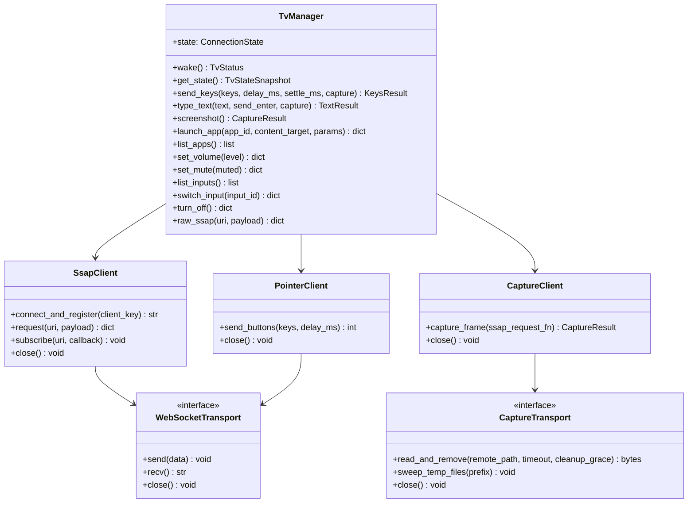

# lg-smtv-mcp

*   **Author:** kiskaadee
*   **Status:** Draft
*   **Date:** 2026-11-15

--------------------------------------------------------------------------------

## Overview

`lg-smtv-mcp` is a Python Model Context Protocol (MCP) server for local-network control of a single pre-paired LG webOS Smart TV. It runs primarily as a long-lived `streamable-http` daemon on a homelab server on the same LAN (with `stdio` supported for local testing), keeping the Simple Service Access Protocol (`SSAP`, LG webOS's local JSON-over-WebSocket control protocol on `wss://<TV_IP>:3001`), pointer input socket, `subscribe` state cache, and optional [LG Developer Mode](https://webostv.developer.lg.com/develop/getting-started/developer-mode-app) `asyncssh`/SFTP session (`prisoner@<TV_IP>:9922`) warm. The server contains no LLM or vision-model calls: UI navigation loops live in the MCP host (such as Antigravity, Claude, or a closed-set action-router model like `gemini-decision-1`), while `lg-smtv-mcp` exposes deterministic, decision-model-friendly tools and composite actions (such as batched key sequences with optional inline `ImageContent` screenshots).

## The Problem

Controlling an LG webOS TV from an AI agent or automation host using one-shot CLI scripts introduces high per-step latency and reliability gaps (documented in [docs/poc/capabilities.md](../poc/capabilities.md) and [docs/poc/crunchyroll-e2e-experiment.md](../poc/crunchyroll-e2e-experiment.md) against `WebOS/4.1.0`):

1. **Per-step handshake overhead:** In the Crunchyroll PoC ([docs/poc/crunchyroll-e2e-experiment.md](../poc/crunchyroll-e2e-experiment.md)), navigating from app launch to episode playback took 13 steps and ~7 minutes (`427s`), largely because each step spawned a fresh process, `wss://:3001` TLS + `register` handshake, `getPointerInputSocket` connection, and `scp` session.
2. **Protocol hazards on persistent connections:** Running `subscribe` streams (`audio/getStatus`, `getForegroundAppInfo`) concurrently with tool calls breaks one-shot `ws.recv()` patterns. Additionally, when the TV is in standby, `wss://:3001` accepts the WebSocket upgrade and closes immediately with `1008 (Try Again Later (EWS))`, and `ime/insertText` silently returns `returnValue: true` even when the native keyboard is closed.
3. **Unbounded token and `/tmp` costs:** Without batched key execution, inline image return, and deterministic frame-change detection (`frame_sha256`), the host pays an extra round-trip and vision-model turn on unchanged frames. Without per-call `/tmp` cleanup, repeated captures can exhaust the TV's ~1.2 GB RAM.

`lg-smtv-mcp` solves this by keeping persistent, serialized connections inside a homelab `streamable-http` daemon, failing fast on `1008` standby, degrading only capture operations when the TV's Developer Mode SSH session timer expires, and returning compact state/image payloads.

## Goals

*   Run a continuous `streamable-http` MCP daemon bound to a configurable `HOST` address (defaulting to `127.0.0.1` locally, or the homelab LAN interface when deployed) with constant-time `Authorization: Bearer <token>` authentication, plus `stdio` transport for local test harnesses.
*   Maintain persistent SSAP (`wss://:3001`), pointer input socket, `subscribe` state cache, and optional `asyncssh`/SFTP (`:9922`) connections inside a unified `tv_core` package.
*   Serialize stateful UI and capture operations (`keys`, `type_text`, `screenshot`) with bounded contention while keeping read-only state queries non-blocking.
*   Fail fast on WebSocket close code `1008` (`TV_OFFLINE_STANDBY`) for mutating tools, return cached flat fields with `connected: false, stale: true` for read-only queries, and provide an explicit `tv_wake` tool using configurable Wake-on-LAN broadcast.
*   Expose decision-model-friendly composite tools (`keys` with delays and optional inline `ImageContent`, `type_text`, `launch` with deep-link helpers, `screenshot` with `frame_sha256` and `changed_since_last`, `set_volume` with configurable `max_volume=40` cap, explicit `turn_off` / `switch_input`, and opt-in `ENABLE_RAW_SSAP=true`).
*   Provide a one-time CLI `pair` command for interactive on-screen `PROMPT` registration, `client-key` persistence, and optional `--fetch-ssh-key` Developer Mode key retrieval.
*   Verify all behavior offline via `pytest` contract tests over `Protocol` mocks, passing `ruff` and `pyright` inside `nix develop`.

## Non-Goals

*   Embedding LLM/VLM API keys, outbound model calls, or an internal vision-navigation loop inside `lg-smtv-mcp`.
*   Adding an extra HTTP or IPC wrapper service behind the MCP server.
*   Exposing arbitrary SSH command execution on the TV or retaining screenshot files in `/tmp`.
*   Multi-TV fleet management or interactive `PROMPT` pairing inside MCP tool calls.
*   Implicitly waking the TV on normal control or state-query calls.

## Open Questions

None. All architectural questions from the initial RFC have been resolved.

## Critical User Journeys (CUJs)

### CUJ 1: Standby Detection and Explicit Wake

*   **Given**: The TV is in standby (`wss://<TV_IP>:3001` closes with `1008 Try Again Later (EWS)`), and the daemon is running in `STANDBY_OFFLINE` state.
*   **When**: An MCP client calls `launch("youtube.leanback.v4")`.
*   **Then**: The tool fails fast with `TV_OFFLINE_STANDBY` without sending a Wake-on-LAN packet. The client then calls `tv_wake`, which broadcasts the WoL magic packet to `<TV_MAC>` on the configured broadcast address/port, polls until `1008` clears and `register` + `subscribe` succeed (`~30–35s` typical cold wake within a `45s` budget), and returns the online status.

### CUJ 2: Vision-Guided UI Navigation with Batched Keys and Change Detection

*   **Given**: The TV is online and Developer Mode SSH (`:9922`) is active.
*   **When**: A host decision loop calls `keys(["LEFT", "UP", "ENTER"], delay_ms=250, settle_ms=1000, capture=True)`.
*   **Then**: `tv_core` serializes the operation, validates key names against the allowlist, sends the three button frames over the persistent pointer socket, waits `settle_ms`, captures and cleans up the remote screenshot into memory, and returns `keys_sent: true`, inline `ImageContent`, `frame_sha256`, and `changed_since_last`.

### CUJ 3: Graceful Degradation When Developer Mode SSH Expires

*   **Given**: The TV is online, SSAP and pointer sockets are connected, and Developer Mode SSH (`:9922`) is disabled or expired.
*   **When**: A client calls `keys(["DOWN", "ENTER"], capture=True)` or `set_volume(15)`.
*   **Then**: `set_volume(15)` succeeds. `keys(..., capture=True)` executes the keystrokes and returns partial success (`keys_sent: true`, `capture_error: "SCREENSHOT_UNAVAILABLE: ..."`) so the caller knows not to re-send the keys.

### CUJ 4: One-Time CLI Pairing

*   **Given**: A new or reset TV has no saved `client-key` on the homelab server.
*   **When**: The operator runs `lg-smtv-mcp pair --ip <TV_IP>` (optionally with `--fetch-ssh-key`) from the terminal and accepts the on-screen `PROMPT` with the physical remote.
*   **Then**: The CLI saves the returned `client-key` (and optional `webos_rsa` with `0600` permissions) to the configured path, allowing the `streamable-http` daemon to start and register non-interactively.

## Technical Plan (Architecture)

### 1. Package & Module Layout

All runtime code lives under `src/lg_smtv_mcp/`, separating the transport/protocol boundaries and state machine (`tv_core`) from the MCP tool surface (`server.py`), HTTP Bearer auth (`auth.py`), and CLI entrypoints (`cli.py`).

| Module | Responsibility |
| :--- | :--- |
| `src/lg_smtv_mcp/config.py` *(planned)* | Typed `TvConfig` loaded from env vars / `.env` (`TV_IP`, `TV_MAC`, `WOL_BROADCAST`, `CLIENT_KEY_PATH`, `SSH_KEY_PATH`, `WEBOS_SSH_PASSPHRASE`, `SSH_KNOWN_HOSTS_PATH`, `HOST`, `PORT`, `ALLOWED_HOSTS`, `MCP_BEARER_TOKEN`, `MAX_VOLUME`, `ENABLE_RAW_SSAP`). |
| `src/lg_smtv_mcp/errors.py` *(planned)* | Typed domain exceptions and error codes (`TV_OFFLINE_STANDBY`, `PAIRING_REQUIRED`, `SCREENSHOT_UNAVAILABLE`, `LOCK_TIMEOUT`, `WAKE_TIMEOUT`, `INVALID_ARGUMENT`). |
| `src/lg_smtv_mcp/tv_core/protocols.py` *(planned)* | Thin Python `Protocol` interfaces (`WebSocketTransport`, `CaptureTransport`) enabling offline contract tests. |
| `src/lg_smtv_mcp/tv_core/ssap.py` *(planned)* | `SsapClient`: single background reader task routing frames by `msg["id"]` to `asyncio.Future`s and `subscribe` callbacks; `PERMISSIONS` constant; `register` + `1008` detection; WebSocket keepalive and pending-`Future` cleanup on disconnect. |
| `src/lg_smtv_mcp/tv_core/pointer.py` *(planned)* | `PointerClient`: acquires `getPointerInputSocket`, sends plain-text `type:button` frames, and automatically re-acquires the socket if dropped. |
| `src/lg_smtv_mcp/tv_core/capture.py` *(planned)* | `CaptureClient`: persistent Developer Mode `asyncssh` SFTP session, orphaned `/tmp` sweep on connect/reconnect, `executeOneShot` trigger + bounded SFTP pull/remove, and `frame_sha256` / `changed_since_last` tracking. |
| `src/lg_smtv_mcp/tv_core/manager.py` *(planned)* | `TvManager`: single-owner connection loop + state machine, `send_wol` helper, `subscribe` state cache, asymmetric reconnect backoff, `CaptureClient` teardown on `STANDBY_OFFLINE`, `.client_key.json` reload on `PAIRING_REQUIRED` backoff/`SIGHUP`, and `ui_lock` (`25s` acquire timeout) serializing UI/capture operations. |
| `src/lg_smtv_mcp/auth.py` *(planned)* | Minimal ASGI Bearer token middleware (`hmac.compare_digest` on `Authorization: Bearer <token>`) wrapping FastMCP's `streamable_http_app()` and `TransportSecuritySettings`. |
| `src/lg_smtv_mcp/server.py` *(planned)* | FastMCP tool definitions, `ImageContent` formatting, partial-success shaping, `max_volume` enforcement, `ENABLE_RAW_SSAP` gating, and ASGI `lifespan` wiring for `TvManager` + `SIGHUP`. |
| `src/lg_smtv_mcp/cli.py` *(planned)* | CLI entrypoint supporting `serve` (`streamable-http` with fail-closed `MCP_BEARER_TOKEN` check, or `stdio`) and one-time interactive `pair` (`.client_key.json` + optional `--fetch-ssh-key`). |

| Component | Key Contract Signatures |
| :--- | :--- |
| `TvManager` | `wake() -> TvStatus`, `get_state() -> TvStateSnapshot`, `send_keys(keys, delay_ms, settle_ms, capture) -> KeysResult`, `type_text(text, send_enter, capture) -> TextResult`, `screenshot() -> CaptureResult`, `launch_app(app_id, content_target, params) -> dict`, `list_apps() -> list[dict]`, `set_volume(level) -> dict`, `set_mute(muted) -> dict`, `list_inputs() -> list[dict]`, `switch_input(input_id) -> dict`, `turn_off() -> dict`, `raw_ssap(uri, payload) -> dict` |
| `SsapClient` | `async connect_and_register(client_key: str \| None) -> str`, `async request(uri: str, payload: dict \| None) -> dict`, `async subscribe(uri: str, callback: Callable[[dict], None]) -> None`, `async close() -> None` |
| `PointerClient` | `async send_buttons(keys: list[str], delay_ms: int) -> int`, `async close() -> None` |
| `CaptureClient` | `async capture_frame(ssap_request_fn: Callable[[str, dict], Awaitable[dict]]) -> CaptureResult`, `async close() -> None` |
| `WebSocketTransport` | `async send(data: str) -> None`, `async recv() -> str`, `async close() -> None` |
| `CaptureTransport` | `async read_and_remove(remote_path: str, timeout: float, cleanup_grace: float) -> bytes`, `async sweep_temp_files(prefix: str) -> None`, `async close() -> None` |

### 2. Connection State Machine, Frame Dispatch & Concurrency

*   **SSAP `msg["id"]` Multiplexer:** `SsapClient` runs one background `_reader_loop()` task that owns `ws.recv()`. Responses to one-shot `request()` calls resolve matching `asyncio.Future`s by `msg["id"]`. Live-verified `subscribe` streams on `WebOS/4.1.0` (`ssap://audio/getStatus`—where `volume` and `mute` are top-level and `soundOutput` is nested under `payload["volumeStatus"]["soundOutput"]`—and `ssap://com.webos.applicationManager/getForegroundAppInfo`) update the in-memory `TvStateSnapshot` in `TvManager`. Mutating requests push subscription update frames before their own request response frame, which `msg["id"]` routing demultiplexes. On disconnect, `_reader_loop()`'s `finally:` block fails all pending `Future`s with `TV_OFFLINE_STANDBY`.
*   **Standby & Fail-Fast:** WebSocket close code `1008` (`Try Again Later (EWS)`), ping timeout (`ping_interval=10, ping_timeout=5`), or `open_timeout` (`3.0–4.0s`) transitions `TvManager` to `STANDBY_OFFLINE` and tears down any open `CaptureClient` SSH/SFTP session (which reconnects lazily on the next capture). Mutating tools fail fast with `TV_OFFLINE_STANDBY` without triggering WoL. Read-only queries (`get_state`) bypass `ui_lock` and return the flat state dict (`connected: false, stale: true` with cached values retained from the last online update).
*   **Single-Owner Reconnect, Wake & Key Reload:** A single connection loop owns `wss://:3001` transitions so `tv_wake` and background reconnect (`2s -> 5s -> 15s -> 30s`) never race. Calling `tv_wake` in `STANDBY_OFFLINE` sends the WoL magic packet, signals the connection loop into `WAKING` (`~1s` polling up to a `45s` `WAKE_TIMEOUT` budget, covering `~30–35s` empirical cold standby boot), and awaits a shared connection event. Concurrent `tv_wake` calls in `WAKING` coalesce onto the in-flight attempt; `tv_wake` in `CONNECTED` returns `{status: "already_connected", elapsed_ms: 0}`; `tv_wake` in `PAIRING_REQUIRED` fails fast with `PAIRING_REQUIRED`. In `PAIRING_REQUIRED`, `TvManager` re-checks `CLIENT_KEY_PATH` (`{ip: client_key}` JSON, written atomically via `os.replace` by `cli.py pair`) on its backoff tick or `SIGHUP` (logging and remaining in `PAIRING_REQUIRED` if the file is missing or malformed).
*   **UI/Capture Serialization & Timeout Budget:** `send_keys`, `type_text`, and `screenshot` acquire `ui_lock` (`asyncio.Lock`) with a `25s` acquire timeout (`LOCK_TIMEOUT` if exceeded). `keys` validates key names against a strict webOS button allowlist (`UP`, `DOWN`, `LEFT`, `RIGHT`, `ENTER`, `BACK`, `HOME`, `EXIT`, `PLAY`, `PAUSE`, `STOP`, `REWIND`, `FASTFORWARD`, `RED`, `GREEN`, `YELLOW`, `BLUE`, `VOLUMEUP`, `VOLUMEDOWN`, `MUTE`, `CHANNELUP`, `CHANNELDOWN`, `INFO`, `GUIDE`, `MENU`, `CC`, `0`–`9`), rejecting unknown names or control characters (`\r`, `\n`) with `INVALID_ARGUMENT`, and bounds `1 <= len(keys) <= 20`, `0 <= delay_ms <= 500`, and `0 <= settle_ms <= 2000`. `CaptureClient.capture_frame()` wraps SSH connect + `executeOneShot` + SFTP read in a shared `6s` deadline (`asyncio.timeout(6.0)`) plus a `1–2s` `finally: sftp.remove()` grace period (`<= 8s` capture phase), keeping worst-case `keys` + `capture` hold time within the `25s` `ui_lock` budget.

### 3. MCP Tool Surface

All tools return structured JSON payloads (plus inline MCP `ImageContent` when `capture=True` or `screenshot` succeeds).

| Tool | Inputs | Output / Behavior | Error Codes |
| :--- | :--- | :--- | :--- |
| `tv_wake` | *(none)* | Coalesced WoL wake to `<TV_MAC>` via `WOL_BROADCAST`; polls up to `45s`; returns `{status, elapsed_ms}` (`already_connected` if already online). | `WAKE_TIMEOUT`, `PAIRING_REQUIRED` |
| `get_state` | *(none)* | Lock-free read returning flat dict (`connected`, `stale`, `volume`, `muted`, `sound_output`, `foreground_app`, `last_updated`; cached fields retain last known values when `connected: false, stale: true`). | *(never fails on standby)* |
| `keys` | `keys: list[str]`, `delay_ms: int = 250`, `settle_ms: int = 800`, `capture: bool = False` | Validates allowlist and bounds; acquires `ui_lock`; sends pointer buttons; if `capture=True`, captures frame. On SSH failure after keys succeed, returns `{keys_sent: true, count, capture_error}` (partial success). | `TV_OFFLINE_STANDBY`, `PAIRING_REQUIRED`, `LOCK_TIMEOUT`, `INVALID_ARGUMENT` |
| `type_text` | `text: str`, `send_enter: bool = True`, `capture: bool = False` | Acquires `ui_lock`; calls `ime/insertText` + optional `sendEnterKey` (requires native on-screen keyboard to be open); if `capture=True`, captures frame (returning `{text_sent: true, capture_error}` partial success on SSH failure). | `TV_OFFLINE_STANDBY`, `PAIRING_REQUIRED`, `LOCK_TIMEOUT` |
| `screenshot` | *(none)* | Acquires `ui_lock`; captures frame into memory and removes remote temp file; returns `ImageContent` + `{frame_sha256, changed_since_last, size_bytes}`. | `TV_OFFLINE_STANDBY`, `PAIRING_REQUIRED`, `SCREENSHOT_UNAVAILABLE`, `LOCK_TIMEOUT` |
| `launch` | `app_id: str`, `content_target: str \| None = None`, `params: dict \| None = None` | Calls `ssap://system.launcher/launch` with `{"id": app_id, "params": ...}`. When `content_target` is provided, sets `params["contentTarget"] = content_target` (overriding any `params["contentTarget"]`; see [docs/poc/capabilities.md](../poc/capabilities.md)). | `TV_OFFLINE_STANDBY`, `PAIRING_REQUIRED` |
| `list_apps` | *(none)* | Calls `com.webos.applicationManager/listLaunchPoints`; returns compact `[{id, title}]`. | `TV_OFFLINE_STANDBY`, `PAIRING_REQUIRED` |
| `set_volume` | `level: int` | Rejects with `INVALID_ARGUMENT` if `level < 0` or `level > MAX_VOLUME` (default `40`); otherwise calls `audio/setVolume`. | `TV_OFFLINE_STANDBY`, `PAIRING_REQUIRED`, `INVALID_ARGUMENT` |
| `set_mute` | `muted: bool` | Calls `audio/setMute`. | `TV_OFFLINE_STANDBY`, `PAIRING_REQUIRED` |
| `list_inputs` | *(none)* | Calls `tv/getExternalInputList`; returns `[{id, label, connected}]`. | `TV_OFFLINE_STANDBY`, `PAIRING_REQUIRED` |
| `switch_input` | `input_id: str` | Explicit input switch via `tv/switchInput`. | `TV_OFFLINE_STANDBY`, `PAIRING_REQUIRED` |
| `turn_off` | *(none)* | Explicit power off via `system/turnOff`. | `TV_OFFLINE_STANDBY`, `PAIRING_REQUIRED` |
| `raw_ssap` | `uri: str`, `payload: dict \| None = None` | Registered **only** when `ENABLE_RAW_SSAP=true`; forwards single SSAP request. | `TV_OFFLINE_STANDBY`, `PAIRING_REQUIRED` |

### 4. Runtime Configuration, Security & Daemon Deployment

*   **Network & Auth:** `streamable-http` binds to `HOST` (default `127.0.0.1` for local dev; `<SERVER_IP>` on the LAN when deployed) and `PORT` (default `8765`). Startup fails closed if `MCP_BEARER_TOKEN` is unset or whitespace-only. Requests require `Authorization: Bearer <token>` verified via `hmac.compare_digest`. `TransportSecuritySettings` derives `allowed_hosts` / `allowed_origins` from `HOST`/`PORT`, `127.0.0.1`/`localhost`, and optional `ALLOWED_HOSTS`.
*   **ASGI `lifespan` Ownership:** FastMCP/Starlette's ASGI `lifespan` context manager starts `TvManager` on Uvicorn's active event loop, registers `SIGHUP` via `loop.add_signal_handler`, and closes `SsapClient`, `PointerClient`, and `CaptureClient` on shutdown.
*   **Developer Mode SSH Lifecycle & Headless `asyncssh` Keying:** Retail LG webOS TVs do not serve `/tmp` screenshots over HTTPS (`:3001`), so `CaptureClient` pulls captures over SFTP from the unprivileged SSH server (`prisoner@<TV_IP>:9922`) provided by LG's official [Developer Mode app](https://webostv.developer.lg.com/develop/getting-started/developer-mode-app) (see [docs/poc/capabilities.md](../poc/capabilities.md)). Port `:9922` is available only while "Dev Mode Status" and "Key Server" are enabled on the TV, and LG automatically disables Developer Mode when its countdown timer expires (at which point `CaptureClient` raises `SCREENSHOT_UNAVAILABLE` while all SSAP and WoL tools continue operating). On a headless `systemd` service, `CaptureClient` connects with `config=[]`, `known_hosts=None` (overridable via `SSH_KNOWN_HOSTS_PATH`), legacy `server_host_key_algs=["ssh-rsa", ...]`, `signature_algs=["ssh-rsa", ...]`, and either a dedicated passwordless service key (`SSH_KEY_PATH`) or `WEBOS_SSH_PASSPHRASE` passed to `asyncssh.connect(..., passphrase=...)`. `lg-smtv-mcp pair --fetch-ssh-key` retrieves `http://<TV_IP>:9991/webos_rsa` and saves it with `0600` permissions.
*   **WoL Broadcast:** `WOL_BROADCAST` defaults to `255.255.255.255` and can be set to the LAN subnet broadcast (e.g., `<LAN_SUBNET_BROADCAST>`) on multi-homed hosts so magic packets exit on the TV's Ethernet/Wi-Fi segment.

### 5. Offline Testing & Nix Environment

*   **Offline Contract Tests:** Tests inject fake `WebSocketTransport` and `CaptureTransport` implementations (plus a fake `send_wol` callback) into `TvManager` to test: `1008` fail-fast vs. `tv_wake` recovery and coalescing, `CaptureClient` teardown on `STANDBY_OFFLINE` and `/tmp/lg_smtv_cap_*.jpg` sweep on reconnect, `msg["id"]` interleaving between `request()` and `subscribe` (`audio/getStatus` nested `soundOutput`), pending `Future` failure on disconnect, pointer socket drop + auto-reacquire, `keys` allowlist/bounds (`INVALID_ARGUMENT`), `ui_lock` `25s` timeout and `CaptureClient` `6s` deadline + `1–2s` cleanup isolation, `keys(..., capture=True)` and `type_text(..., capture=True)` partial success when SSH fails, `finally: sftp.remove()` cleanup on failure, `frame_sha256` / `changed_since_last`, `PAIRING_REQUIRED` key reload (including malformed JSON handling), `MAX_VOLUME` guardrail, `ENABLE_RAW_SSAP` gating, and fail-closed Bearer auth.
*   **`flake.nix` Updates:** Expand `pythonEnv` (`pkgs.python314.withPackages`, verified with `nix build`: `mcp = "2.3.0"`, `asyncssh = "2.24.0"`, `pytest = "9.1.1"`, `pytest-asyncio = "1.4.1"`) alongside `websockets`, `pyright`, and `ruff`.

## Alternatives Considered

### Alternative A: Single-Process `stdio` Per Client Only

*   **Pros:** Zero HTTP server, port binding, or Bearer token configuration required.
*   **Cons:** Every client session spawns a new process, repeating `wss://:3001` TLS + `register`, `getPointerInputSocket`, and `:9922` SSH handshakes; concurrent clients contend for the TV's single pointer socket.
*   **Reason for Rejection:** `streamable-http` keeps all TV transports and the `subscribe` state cache warm continuously while `stdio` remains available for local test harnesses.

### Alternative B: In-Server Vision Navigation Sub-Loop

*   **Pros:** Could encapsulate multi-step UI navigation behind a single high-level natural-language tool call.
*   **Cons:** Couples a local hardware driver to external LLM/VLM API keys, provider SDKs, model selection, and prompt engineering.
*   **Reason for Rejection:** `lg-smtv-mcp` stays LLM-free; latency and token overhead are addressed instead via composite tools (`keys(..., capture=True)`) and deterministic `frame_sha256` / `changed_since_last` metadata.

### Alternative C: OpenSSH `ControlMaster` Subprocess for Screenshots

*   **Pros:** Uses system OpenSSH directly for legacy `ssh-rsa` compatibility.
*   **Cons:** Requires managing background `ssh` control sockets, parsing subprocess output/exit codes, and complicates offline unit testing.
*   **Reason for Rejection:** `asyncssh` (`2.24.0`) was verified on Python 3.14 against `:9922` (`config=[]`, explicit `ssh-rsa` algorithms) and wraps behind an async `Protocol` mock.

### Alternative D: Fixed `/tmp/test.jpg` Overwrite Path

*   **Pros:** Bounded to a single file on `/tmp` without explicit delete calls.
*   **Cons:** If `executeOneShot` fails silently or races, SFTP pull can read a stale screenshot from an earlier step.
*   **Reason for Rejection:** Capturing to `/tmp/lg_smtv_cap_<seq>.jpg`, pulling only when `returnValue: true`, calling `sftp.remove()` in `finally:`, and sweeping stale files on reconnect prevents both stale reads and `/tmp` exhaustion on the TV's ~1.2 GB RAM.

### Alternative E: Unconditional `raw_ssap` Tool

*   **Pros:** Allows calling arbitrary SSAP URIs at any time without code changes.
*   **Cons:** Expands the tool schema and weakens guardrails (`max_volume`, explicit `turn_off`) for closed-set decision models.
*   **Reason for Rejection:** `raw_ssap` is omitted by default and registered only when `ENABLE_RAW_SSAP=true` is explicitly configured.

--------------------------------------------------------------------------------

## Risks & Mitigations

| Risk | Impact | Mitigation |
| :--- | :--- | :--- |
| Developer Mode SSH timer expires on TV | Screenshot capture fails (`SCREENSHOT_UNAVAILABLE`) | Degrade only `screenshot` / `capture=True` (returning partial success on `keys` / `type_text`); keep all SSAP and WoL tools active. |
| Orphaned `/tmp/lg_smtv_cap_*.jpg` on SSH stall | Gradual `/tmp` RAM growth on TV (~1.2 GB RAM) | Per-call `finally: sftp.remove()` under `1–2s` grace + sweep of `/tmp/lg_smtv_cap_*.jpg` on SFTP connect/reconnect. |
| Concurrent `tv_wake` / reconnect race or cold wake delay | Duplicate sockets or premature `WAKE_TIMEOUT` | Single-owner connection loop coalescing `tv_wake` + `45s` budget (`~30–35s` empirical cold boot). |
| Dev Mode host-key regeneration or headless `known_hosts` failure | SSH connection rejected on `:9922` | Default `known_hosts=None` on LAN with optional `SSH_KNOWN_HOSTS_PATH` override. |
| Pointer frame newline injection or oversized `keys` batch | Unintended pointer commands or `ui_lock` starvation | Strict button allowlist (rejecting `\r`/`\n`), batch/delay caps, and `25s` `ui_lock` timeout. |

--------------------------------------------------------------------------------

## Non-Functional Requirements

*   **Security & Privacy:** `streamable-http` binds to configurable `HOST` (default `127.0.0.1`, or `<SERVER_IP>` on private LAN), fails closed if `MCP_BEARER_TOKEN` is unset, enforces `Authorization: Bearer <token>` via `hmac.compare_digest`, and configures MCP `TransportSecuritySettings`. Arbitrary SSH command execution is never exposed. `.client_key.json`, `.env`, SSH keys, and `*.jpg` captures are excluded from version control.
*   **Performance & Latency:** Persistent SSAP, pointer, and `asyncssh` SFTP connections eliminate per-step TLS/SSH handshakes (~8–10s/step in PoC); batched `keys(..., capture=True)` and `frame_sha256` / `changed_since_last` allow the host to skip redundant vision turns.
*   **Operational Resilience:** WebSocket `1008` fails fast (`TV_OFFLINE_STANDBY`), `ui_lock` times out at `25s` with `LOCK_TIMEOUT`, and Developer Mode SSH expiration degrades only `screenshot` / `capture=True` without disrupting SSAP or WoL tools.

## Detailed Implementation Plan

### Target Files to Create/Modify

#### 1. `flake.nix` (Modify)

*   **Type / Scope:** Nix development shell configuration.
*   **Proposed Changes:** Add `mcp`, `asyncssh`, `pytest`, and `pytest-asyncio` to `pythonEnv` (`pkgs.python314.withPackages`) alongside `websockets`, `pkgs.pyright`, and `pkgs.ruff`. Verify Python 3.14 evaluation via `nix develop`.

#### 2. `pyproject.toml` (Create)

*   **Type / Scope:** Python package metadata, build, and tool configuration.
*   **Proposed Changes:** Define `lg-smtv-mcp` package under `src/`, console script entrypoint `lg-smtv-mcp = lg_smtv_mcp.cli:main`, `pytest` (`asyncio_mode = "auto"`), `ruff`, and `pyright` (`src/` + `tests/` paths, strict/standard type-checking).

#### 3. `.gitignore` and `.env.example` (Modify / Create)

*   **Type / Scope:** Secret hygiene and runtime configuration template.
*   **Proposed Changes:** Ensure `.gitignore` excludes `.client_key.json`, `.env`, `*.jpg`, and SSH keys so no personal LAN IPs, MACs, keys, or captures are committed (per [AGENTS.md](../../AGENTS.md) Section 4). Create `.env.example` with placeholder values (`TV_IP=<TV_IP>`, `TV_MAC=<TV_MAC>`, `WOL_BROADCAST=255.255.255.255`, `CLIENT_KEY_PATH=.client_key.json`, `SSH_KEY_PATH=`, `WEBOS_SSH_PASSPHRASE=`, `SSH_KNOWN_HOSTS_PATH=`, `HOST=127.0.0.1`, `PORT=8765`, `ALLOWED_HOSTS=`, `MCP_BEARER_TOKEN=<GENERATE_TOKEN>`, `MAX_VOLUME=40`, `ENABLE_RAW_SSAP=false`).

#### 4. `src/lg_smtv_mcp/__init__.py` and `src/lg_smtv_mcp/errors.py` (Create)

*   **Type / Scope:** Package root and typed domain error taxonomy.
*   **Proposed Changes:** Define `TvError(Exception)` carrying `code: ErrorCode` (`TV_OFFLINE_STANDBY`, `PAIRING_REQUIRED`, `SCREENSHOT_UNAVAILABLE`, `LOCK_TIMEOUT`, `WAKE_TIMEOUT`, `INVALID_ARGUMENT`) and `message: str` so MCP tools map failures deterministically.

#### 5. `src/lg_smtv_mcp/config.py` (Create)

*   **Type / Scope:** Runtime configuration loader.
*   **Proposed Changes:** Define frozen `TvConfig` dataclass and `load_config()` reading environment variables / `.env` without hardcoded personal IPs, MACs, or paths. Validate `HOST`, `PORT`, `ALLOWED_HOSTS`, `MAX_VOLUME` (default `40`), `WOL_BROADCAST`, `SSH_KNOWN_HOSTS_PATH`, `MCP_BEARER_TOKEN` (fail closed if unset/whitespace for `streamable-http`), and `ENABLE_RAW_SSAP` (default `False`).

#### 6. `src/lg_smtv_mcp/tv_core/protocols.py` (Create)

*   **Type / Scope:** Transport abstraction boundaries (`Protocol`s).
*   **Proposed Changes:** Define `WebSocketTransport` (shared by `SsapClient` and `PointerClient`) and `CaptureTransport` `Protocol` interfaces so `tv_core` depends on abstractions and `pytest` injects fakes offline.

#### 7. `src/lg_smtv_mcp/tv_core/ssap.py` (Create)

*   **Type / Scope:** SSAP WebSocket client and frame multiplexer.
*   **Proposed Changes:** Implement `SsapClient` with shared `PERMISSIONS` constant (always sent in `register`, even when reusing `client-key`), `ssl.CERT_NONE` / `check_hostname=False` for self-signed `wss://:3001`, `open_timeout=3.0..4.0s`, `ping_interval=10`, `ping_timeout=5`, `1008` / connect-timeout detection (`TV_OFFLINE_STANDBY`), `PROMPT` detection (`PAIRING_REQUIRED` in daemon mode; interactive wait in CLI `pair`), and a single background `_reader_loop()` routing frames by `msg["id"]` to pending `asyncio.Future`s or `subscribe` handlers (failing all pending `Future`s with `TV_OFFLINE_STANDBY` in `finally:` on disconnect).

#### 8. `src/lg_smtv_mcp/tv_core/pointer.py` (Create)

*   **Type / Scope:** Pointer input WebSocket client.
*   **Proposed Changes:** Implement `PointerClient` calling `com.webos.service.networkinput/getPointerInputSocket`, validating key names against the allowlist, formatting plain-text `type:button\nname:<KEY>\n\n` frames, pacing batches by `delay_ms`, and automatically re-acquiring the socket if closed independently of SSAP.

#### 9. `src/lg_smtv_mcp/tv_core/capture.py` (Create)

*   **Type / Scope:** Developer Mode `asyncssh`/SFTP screenshot client.
*   **Proposed Changes:** Implement `CaptureClient` holding a persistent `asyncssh` SFTP connection (`prisoner@<TV_IP>:9922`, `config=[]`, `known_hosts=None` default or `SSH_KNOWN_HOSTS_PATH`, `server_host_key_algs=["ssh-rsa", ...]`, `signature_algs=["ssh-rsa", ...]`, optional `WEBOS_SSH_PASSPHRASE`), sweeping orphaned `/tmp/lg_smtv_cap_*.jpg` files on SFTP connect/reconnect. On capture: wrap SSH connect + `ssap://com.webos.service.capture/executeOneShot` (`{"path": "/tmp/lg_smtv_cap_<seq>.jpg", "method": "DISPLAY", "format": "JPG"}`) + SFTP read in a shared `6s` deadline (`asyncio.timeout(6.0)`), pull into memory only if `returnValue: true`, run `await sftp.remove(remote_path)` in `finally:` under a `1–2s` cleanup timeout, compute `frame_sha256` and `changed_since_last`, and raise `SCREENSHOT_UNAVAILABLE` if Developer Mode SSH is disabled/expired.

#### 10. `src/lg_smtv_mcp/tv_core/manager.py` and `src/lg_smtv_mcp/tv_core/__init__.py` (Create)

*   **Type / Scope:** Single-owner connection state machine, `subscribe` cache, and WoL helper.
*   **Proposed Changes:** Implement `send_wol(mac, broadcast_addr, port=9)` UDP magic packet helper and `TvManager` managing `ConnectionState` (`CONNECTING`, `CONNECTED`, `STANDBY_OFFLINE`, `WAKING`, `PAIRING_REQUIRED`) via a single connection loop that coalesces `tv_wake` (`45s` `WAKE_TIMEOUT` budget; idempotent in `CONNECTED`; fast-fail in `PAIRING_REQUIRED`), `subscribe` cache (`audio/getStatus` with nested `volumeStatus.soundOutput`, `getForegroundAppInfo`), asymmetric reconnect backoff (`2s -> 5s -> 15s -> 30s`), `CaptureClient` teardown on `STANDBY_OFFLINE`, `CLIENT_KEY_PATH` (`{ip: client_key}`) reload on `PAIRING_REQUIRED` backoff ticks or `SIGHUP` (logging and staying in `PAIRING_REQUIRED` on malformed JSON), `ui_lock` (`asyncio.Lock` with `25s` acquire timeout), lock-free `get_state()` returning the flat state dict with `connected: false, stale: true` when offline, and partial-success handling on `send_keys(..., capture=True)` and `type_text(..., capture=True)`.

#### 11. `src/lg_smtv_mcp/auth.py` (Create)

*   **Type / Scope:** Minimal HTTP Bearer token middleware and transport security.
*   **Proposed Changes:** Implement a minimal ASGI middleware verifying `Authorization: Bearer <token>` via `hmac.compare_digest` (returning `401` on missing/invalid token) around FastMCP's built-in `streamable_http_app()` and configure MCP `TransportSecuritySettings` from `HOST`/`PORT`, `127.0.0.1`/`localhost`, and optional `ALLOWED_HOSTS`.

#### 12. `src/lg_smtv_mcp/server.py` (Create)

*   **Type / Scope:** FastMCP server, ASGI `lifespan`, and tool definitions.
*   **Proposed Changes:** Bind `TvManager` startup, `SIGHUP` `loop.add_signal_handler`, and graceful shutdown to FastMCP's ASGI `lifespan` context manager. Register all 12 default tools (`tv_wake`, `get_state`, `keys`, `type_text`, `screenshot`, `launch`, `list_apps`, `set_volume`, `set_mute`, `list_inputs`, `switch_input`, `turn_off`) and conditionally register `raw_ssap` only when `ENABLE_RAW_SSAP=true`. Document the `type_text` native-keyboard requirement in its tool description, enforce `keys` allowlist/bounds and `0 <= level <= MAX_VOLUME`, and format inline `ImageContent` + metadata.

#### 13. `src/lg_smtv_mcp/cli.py` (Create)

*   **Type / Scope:** CLI entrypoint (`serve`, `pair`).
*   **Proposed Changes:** Implement `serve --transport [streamable-http|stdio]` (failing closed if `MCP_BEARER_TOKEN` is unset for `streamable-http`; delegating to FastMCP's built-in `streamable-http` app wrapped with `auth.py`, or `FastMCP.run(transport="stdio")`) and `pair --ip <TV_IP> [--fetch-ssh-key]` for one-time interactive `PROMPT` pairing with atomic `os.replace` persistence to `.client_key.json` (`{ip: client_key}`) and optional `http://<TV_IP>:9991/webos_rsa` download saved with `0600` permissions.

#### 14. `tests/` (`conftest.py`, `test_ssap.py`, `test_manager.py`, `test_capture.py`, `test_server_auth.py`) (Create)

*   **Type / Scope:** Offline `pytest` unit and contract test suite.
*   **Proposed Changes:** Provide `WebSocketTransport` and `CaptureTransport` fakes (plus a `send_wol` stub) and verify: `msg["id"]` multiplexing with interleaved `subscribe` updates (`audio/getStatus` nested `soundOutput`); pending `Future` failure on disconnect; `1008` fail-fast vs. `tv_wake` recovery, coalescing, `CONNECTED` no-op, and `45s` `WAKE_TIMEOUT`; `CaptureClient` teardown on `STANDBY_OFFLINE` and `/tmp/lg_smtv_cap_*.jpg` sweep on reconnect; offline `get_state` flat dict (`connected: false, stale: true`); `keys` allowlist/newline/bounds rejection; `ui_lock` `25s` timeout and `CaptureClient` `6s` deadline + `1–2s` cleanup timeout isolation; pointer auto-reacquire; `keys(..., capture=True)` and `type_text(..., capture=True)` partial success when SSH fails; `finally: sftp.remove()` cleanup; `frame_sha256` / `changed_since_last`; `PAIRING_REQUIRED` key reload on backoff/`SIGHUP` (including malformed JSON); `set_volume` `INVALID_ARGUMENT` above `MAX_VOLUME`; `ENABLE_RAW_SSAP` gating; and fail-closed Bearer auth `401`/constant-time check.

#### 15. `deploy/lg-smtv-mcp.service` and `README.md` (Create / Modify)

*   **Type / Scope:** Deployment template and repository documentation.
*   **Proposed Changes:** Add a placeholder `systemd` unit file (`deploy/lg-smtv-mcp.service`) referencing `EnvironmentFile` and `nix develop --command lg-smtv-mcp serve`, and update `README.md` with setup, `pair --fetch-ssh-key` / Developer Mode SSH setup, `.env`, and verification instructions.

### Verification Plan

*   **Environment & Build:** `nix develop --command python -c "import lg_smtv_mcp"`
*   **Static Analysis & Linting:** `nix develop --command ruff check .` and `nix develop --command pyright`
*   **Offline Unit & Contract Tests:** `nix develop --command pytest` (100% offline against `Protocol` mocks; zero packets sent to physical hardware)
*   **Manual Live-TV Integration Checks:** Explicit operator-run verification of `pair --fetch-ssh-key`, `tv_wake` from `1008` standby, `keys(..., capture=True)` with `asyncssh`, and `set_volume` cap against `<TV_IP>`.

--------------------------------------------------------------------------------

*Drafted with EGM*
